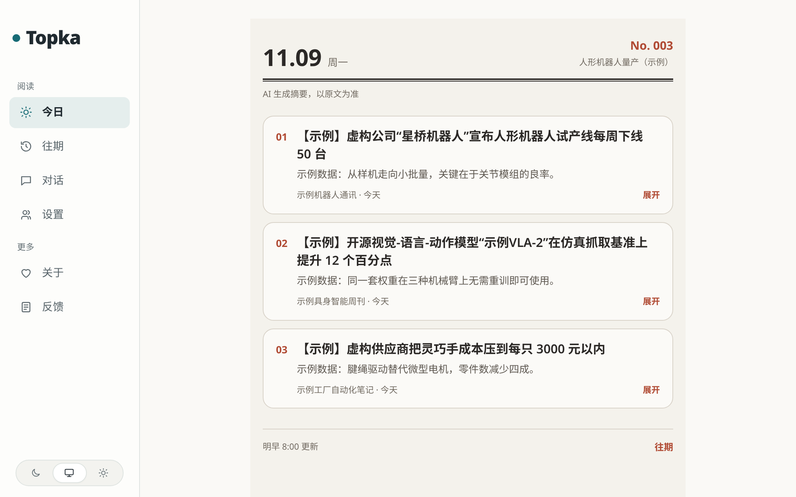
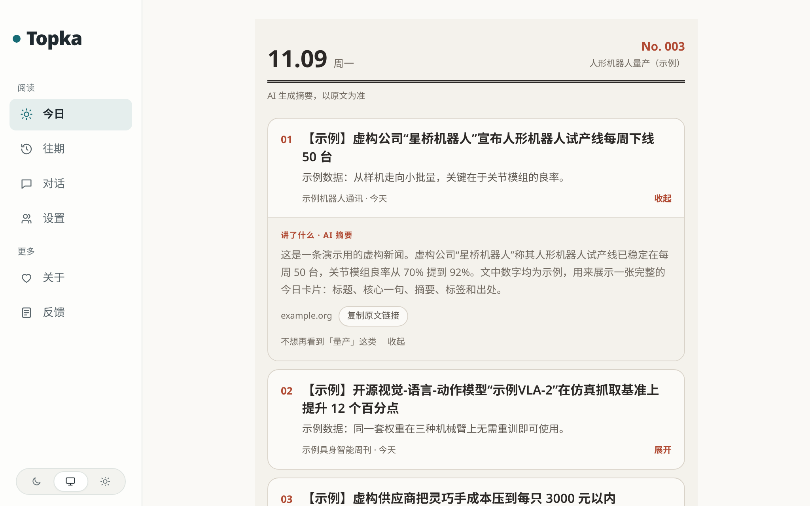
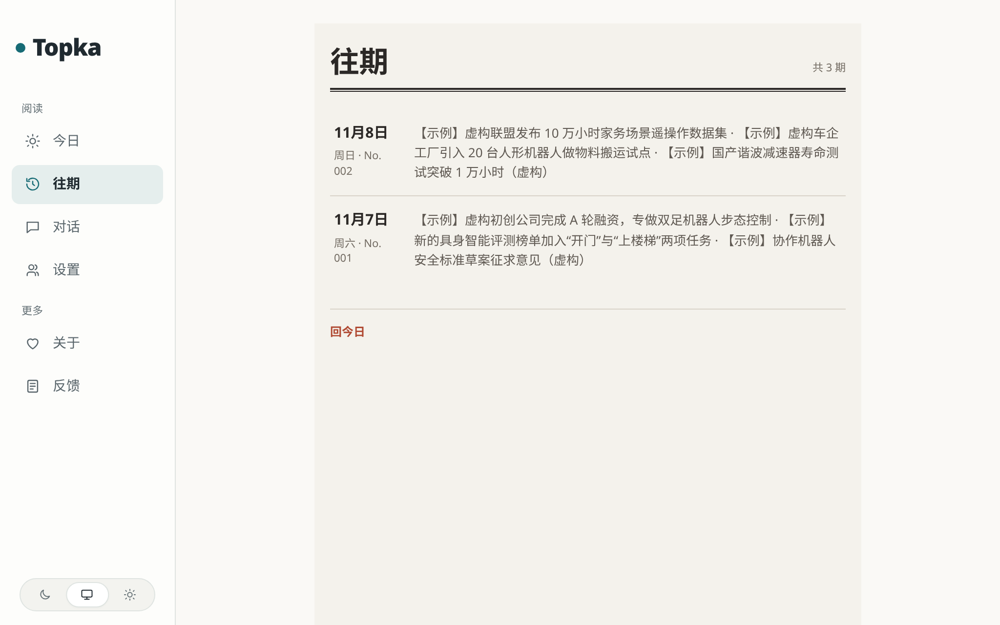
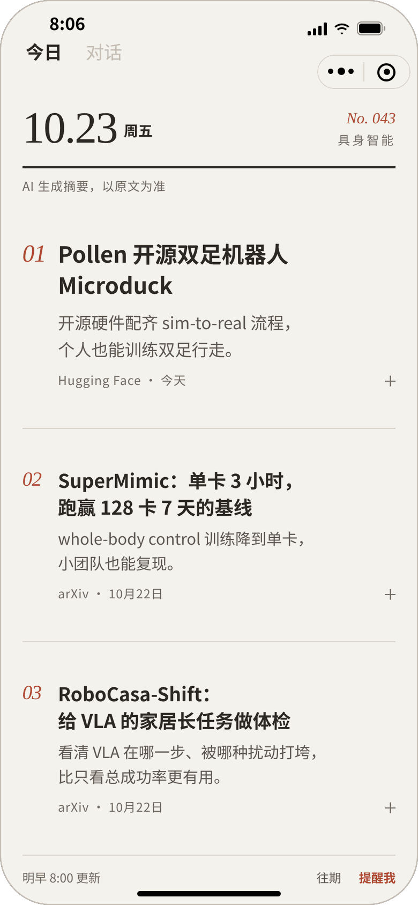
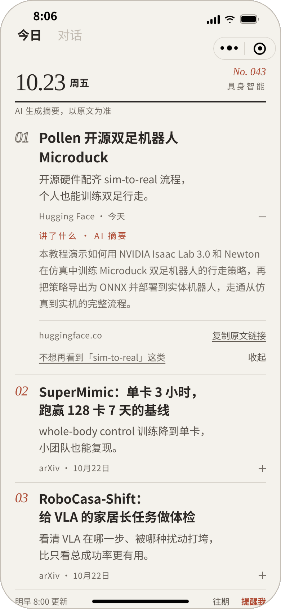
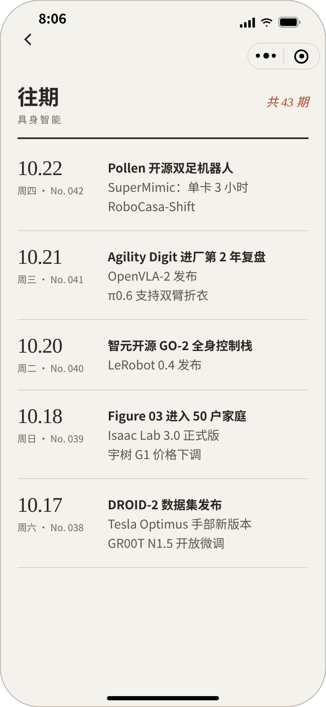
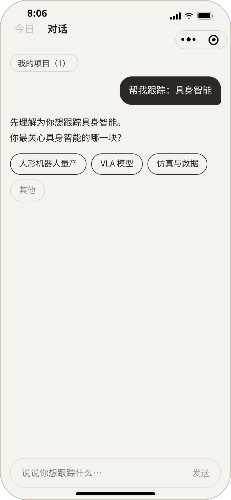
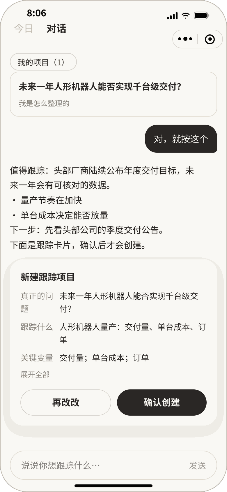
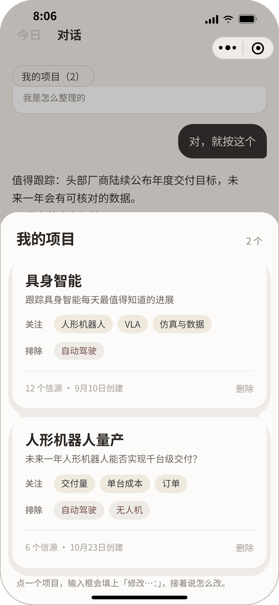

<div align="center">

[简体中文](README.md) · **English**

# Topka



> *"Only what changed. If nothing clears the bar, that day's issue is shorter, or empty. Never padded."*

[](LICENSE)
[](CHANGELOG.md)
[](#quick-start)
[](#real-sources-and-a-model)

**Tell Topka what to watch. Every morning at 8 it picks up to three items from your sources worth reading, each linking to the original.**

**[Try it online →](https://cyrusaurora.github.io/topka/)**

<!-- doc-test: run quickstart; timeout 1800 -->
```bash
git clone https://github.com/CyrusAurora/topka.git && cd topka
docker run --rm -u "$(id -u):$(id -g)" -v "$PWD:/app" -w /app node:26-trixie-slim node scripts/init-env.ts --demo
docker compose up -d --build
```

<sub>Ships with demo data and a demo model. No API key needed.</sub>

[Quick start](#quick-start) · [Real sources and a model](#real-sources-and-a-model) · [How it works](#how-it-works) · [Troubleshooting](#troubleshooting)

</div>

---

## See it

Open a card for the summary, the source and a copy-link button:



Every issue stays in Archive:



As a WeChat mini-program or a mobile app:

<table>
<tr>
<td align="center" width="33%"><br><sub>Today's three</sub></td>
<td align="center" width="33%"><br><sub>Open one for the summary and source link</sub></td>
<td align="center" width="33%"><br><sub>Archive</sub></td>
</tr>
<tr>
<td align="center" width="33%"><br><sub>Say what to follow, tap an option</sub></td>
<td align="center" width="33%"><br><sub>Confirm the card to create the project</sub></td>
<td align="center" width="33%"><br><sub>My projects: what to watch, what to skip</sub></td>
</tr>
</table>

---

## Quick start

You need Docker Compose v2, `git` and about 3 GB of disk; 2 cores and 4 GB of RAM are enough. The site runs on port 3000 of this machine.

**1. Clone and generate `.env`**

<!-- doc-test: skip the quick start block above runs these same commands -->
```bash
git clone https://github.com/CyrusAurora/topka.git && cd topka
docker run --rm -u "$(id -u):$(id -g)" -v "$PWD:/app" -w /app node:26-trixie-slim node scripts/init-env.ts --demo
```

It prints the site address and the admin password. If port 3000 is taken, add `--port 127.0.0.1:3300` to that command; the port lives in one place, `PORT` in `.env`.

**2. Start**

<!-- doc-test: skip the quick start block above runs these same commands -->
```bash
docker compose up -d --build
```

The first build takes from half a minute to a quarter of an hour. Check it is up:

<!-- doc-test: run quickstart; retry 180; expect "ok":true -->
```bash
curl -s "http://$(docker compose port web 3000)/api/health"   # {"app":"topka",…,"ok":true,"db":"ok",…}
```

**3. Sign in**

<!-- doc-test: run quickstart; retry 180; expect demo: ready -->
```bash
docker compose logs setup | grep demo:
```

```text
setup-1  | demo: ready. Log in at /login as demo@example.com
setup-1  | demo: password demo-1be4ef872d6d  (shown once; to reset it: add DEMO_PASSWORD=<10+ characters> to .env, run `docker compose up -d`, then `docker compose exec api npm run demo:seed`)
```

Open <http://localhost:3000/login> and sign in as `demo@example.com` with that password. You get:

- Today: No. 003, three 【示例】 cards
- Archive: the two issues before it
- Chat: say what to watch, answer two or three questions, confirm, and the project exists
- The admin at `/admin`, password `ADMIN_PASSWORD` in `.env`

To fetch real articles before connecting a model, see [tutorial part 2](docs/tutorial.en.md#part-2-real-articles-still-no-model-key).

<!-- doc-test: run quickstart; defer -->
```bash
docker compose down -v   # remove the containers and the data
```

---

## Real sources and a model

A new issue every day needs sources switched on and a model. Both are off by default.

**Sources.** A few hundred ship with the repo. Switch them on in `/admin/sources`, or:

<!-- doc-test: run quickstart; expect 2 -->
```bash
docker compose exec api npm run sources:only -- --id rss-hugging-face --id rss-github-ai
```

**Model.** Any OpenAI-compatible endpoint, in `.env`:

<!-- doc-test: skip lines for .env with placeholder values, not commands -->
```bash
LLM_BASE_URL=https://api.deepseek.com/v1
LLM_API_KEY=sk-...
LLM_MODEL=deepseek-flash
```

Two free options, set up in [Without a paid key](docs/self-hosting.md#without-a-paid-key):

- **Local Ollama**: `COMPOSE_PROFILES=ollama`, then `docker compose exec ollama ollama pull qwen2.5:7b`. Best with a GPU.
- **OpenRouter `:free` models**: list them in `LLM_FREE_MODELS`; only zero-priced models are used.

Then switch on fetching and model calls:

<!-- doc-test: skip turns on collection and model calls, which reach outside services; CI makes no outside calls -->
```bash
sed -i 's/^COLLECT_ENABLED=false/COLLECT_ENABLED=true/; s/^MODEL_CALLS_ENABLED=false/MODEL_CALLS_ENABLED=true/' .env
docker compose up -d
```

Readers can add their own key in Settings (BYOK) so Chat runs on their quota. Every paid call is logged, and per-minute, per-hour and per-day budgets stop spending when reached.

Full deploy: [docs/self-hosting.md](docs/self-hosting.md). Every setting: [docs/configuration.md](docs/configuration.md).

---

## How it works

```
Sources (RSS / web list / JSON / X / WeChat / push)
   │  fetched on a schedule, deduplicated
   ▼
Pre-filter → score twice → title & summary → merge into events
   │
   ▼
Pick for your projects → fix the issue at 08:00 in your time zone (≤3 items, ≤2 per source)
   │
   ▼
Site (Today / Archive) · your own issue feed (Atom)
```

- Scoring and writing prompts live in `industry/`; the default is the AI industry. Retarget by editing that folder: [docs/customize.md](docs/customize.md)
- Pick sources by region when creating a project (`global` / `cn` / `us` / `eu` / `jp`)
- UI in 简体中文 and English; each reader picks a language and time zone
- Summaries and links only, no full-text copies

Diagrams: [docs/architecture.md](docs/architecture.md).

---

## Troubleshooting

| Symptom | Fix |
|---|---|
| `required variable POSTGRES_PASSWORD is missing a value` | Run `init-env` (step 1) |
| `Bind for …:3000 failed: port is already allocated` | Set `PORT=127.0.0.1:3300` in `.env`, then `docker compose up -d` |
| `curl …/api/health` answers, but not as Topka | Use `curl -s "http://$(docker compose port web 3000)/api/health"` |
| No `demo:` lines in `logs setup` | Set `DEMO_SEED=true` in `.env`, then `docker compose up -d` |
| Lost the demo password | Add `DEMO_PASSWORD=at-least-10-chars` to `.env`, `docker compose up -d`, then `docker compose exec api npm run demo:seed` |
| `docker compose logs` lines start with `ESC[2K` | Read the container log directly: `docker logs $(docker compose ps -aq setup)` |
| Sources on, no new articles after a few minutes | Set `COLLECT_ENABLED=true` in `.env`, then `docker compose up -d`; failures show in `/admin/sources` |
| Articles, but no new cards | Connect a model and set `MODEL_CALLS_ENABLED=true`; search the logs for `is not configured` |

More: [troubleshooting](docs/self-hosting.md#troubleshooting).

---

## Docs

[Tutorial](docs/tutorial.en.md) ([中文](docs/tutorial.md)) · [Index](docs/README.md) · [Self-hosting](docs/self-hosting.md) · [Configuration](docs/configuration.md) · [Customize](docs/customize.md) · [Sources](docs/sources.md) · [Contributing](CONTRIBUTING.md) · [Security](SECURITY.md)

## License

MIT, see [LICENSE](LICENSE).

Thanks to [AIHOT](https://github.com/KKKKhazix/AIHOT).
