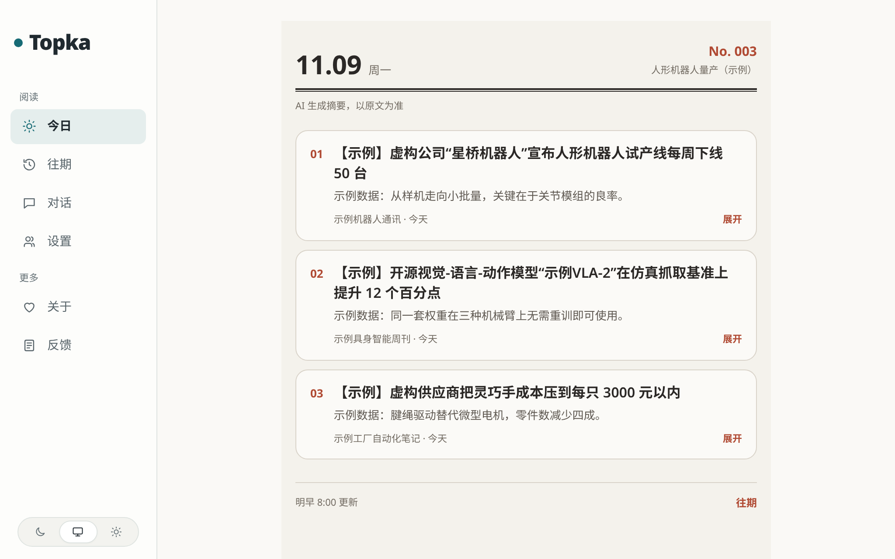
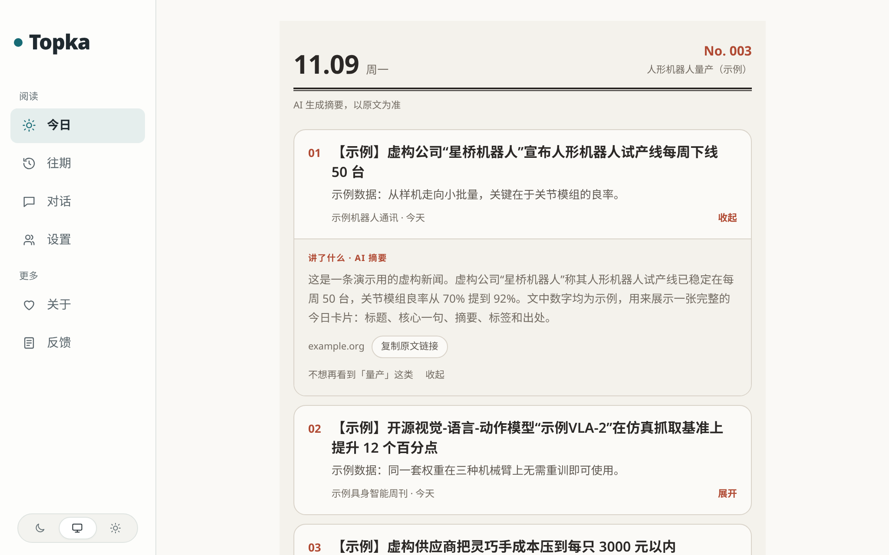
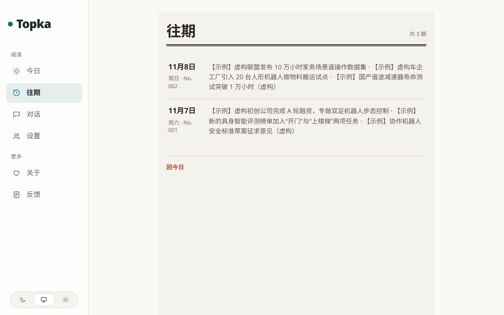

<div align="center">

[简体中文](README.md) · **English**

# Topka



> *"Only what changed. When the evidence is thin, it says so."*

[](LICENSE)
[](CHANGELOG.md)
[](#run-it-first-no-api-key)
[](#connect-real-sources-and-a-model)

**A self-hosted intelligence workbench: say what you are tracking, and every day it picks the few stories from your sources that are worth reading, each one linked back to the original.**

Tell it "track humanoid-robot mass production" and it keeps collecting a fixed set of sources around that,<br>
merges reports of the same thing from different sources into one event, and fixes one issue a day at 08:00 UTC+8 with at most three cards by default.<br>
When fewer than three stories clear the bar, it shows fewer cards instead of padding the page.

```bash
git clone https://github.com/CyrusAurora/topka.git && cd topka
docker run --rm -u "$(id -u):$(id -g)" -v "$PWD:/app" -w /app node:24-trixie-slim node scripts/init-env.ts
DEMO_SEED=true docker compose up -d --build
```

<sub>Three commands, log in, and you are looking at the picture above: invented demo data, no API key, nothing fetched from the internet, no model called.</sub>

[See it](#see-it) · [Run it first](#run-it-first-no-api-key) · [Real sources and a model](#connect-real-sources-and-a-model) · [How it works](#how-it-works) · [Honest limits](#honest-limits) · [Troubleshooting](#troubleshooting)

</div>

---

## See it

Open a card and you get the AI-written summary, the source, and a button that copies the original link:



Every earlier issue stays, one row per day, under 往期 (past issues):



<sub>▲ All three are real captures of the current build on the demo data that ships with the repository. Sources, headlines and numbers are invented, which is why every headline starts with 【示例】 ("example"). Follow the [tutorial](docs/tutorial.en.md) and you see exactly these pages, dated the day you run it. The UI is in Chinese.</sub>

Day to day it works like this:

| You | Topka |
|---|---|
| Create a tracking project: what to watch and why | Keeps collecting from the sources bound to it; every article is prefiltered, then scored twice, independently, by a model |
| Do nothing, open 今日 (Today) the next morning | Fixes that day's issue at 08:00 UTC+8: at most three cards by default (`TODAY_CARD_COUNT`, 3–5), at most two from one source, fewer when fewer qualify |
| Open a card | Read the summary and the source, copy the original link in one click |
| Ask in 对话 (chat) | Answers with your own model key (BYOK) and leaves the instance budget alone |
| Want it in another tool | The same content is published as RSS, a public JSON API (`/api/v1`), an MCP endpoint (the standard interface AI assistants use to read a service directly) and `llms.txt` (a site description written for LLMs) |

---

## Run it first (no API key)

### What you need

- **Docker with Compose v2**: `docker compose version` prints a version. Database, backend and web
  server all run in containers; no Node.js or PostgreSQL on the host.
- **`git`**, and about **3 GB** of disk for the images. A 2-core / 4 GB machine is enough.
- **Port 3000 free.** If it is taken, put `PORT=127.0.0.1:3300` in front of every `docker compose up`
  and open 3300. The site is reachable from this machine only by default; for other machines see
  [HTTPS in docs/self-hosting.md](docs/self-hosting.md#https-caddy-profile).

No API key, no GPU, no account anywhere.

### Three steps

**1. Get the code and generate `.env`**

```bash
git clone https://github.com/CyrusAurora/topka.git && cd topka
docker run --rm -u "$(id -u):$(id -g)" -v "$PWD:/app" -w /app node:24-trixie-slim node scripts/init-env.ts
```

The second command writes `.env` with random secrets from a throwaway Node container and prints an
admin password once, plus a reminder (in Chinese) to add a model key. **Ignore the reminder**: the demo
does not use a model.

**2. Start with the demo content**

```bash
DEMO_SEED=true docker compose up -d --build
```

The first build takes 5–15 minutes depending on the network; later starts take seconds. It brings up
PostgreSQL, runs the migrations and writes the demo: a reader account, one tracking project
("人形机器人量产（示例）", humanoid-robot mass production, example) and three days of invented cards.

**3. Read the demo password and log in**

```bash
docker compose logs setup | grep demo:
```

```text
setup-1  | demo: ready. Log in at /login as demo@example.com
setup-1  | demo: password demo-1be4ef872d6d  (shown once; set DEMO_PASSWORD and re-run to reset it)
```

The password is random, yours will differ, and it only appears here, so note it. Open <http://localhost:3000/login> and sign in as
`demo@example.com`.

### You are done when

- 今日 (Today) shows **No. 003** with three numbered cards whose titles start with 【示例】, as in the
  picture at the top of this page.
- Clicking a title expands its summary; 往期 (past issues) on the left lists the two days before.
- The admin is at <http://localhost:3000/admin>, login with `ADMIN_PASSWORD` from `.env`.

Something else on screen? See [Troubleshooting](#troubleshooting). One step further, real articles
arriving (still no model), is [part 2 of the tutorial](docs/tutorial.en.md#part-2-real-articles-still-no-model-key).

Done playing? One command removes it all, database included:

```bash
docker compose down -v
```

---

## Connect real sources and a model

The demo never changes by itself. A real issue every day needs two things: **some sources switched
on** and **a model connected**. Both start off on purpose: without your say-so it fetches no website
and spends no money.

**Sources.** About 400 bundled sources are imported on first start, all switched off. Turn on the ones
you want at `/admin/sources`, or only the named ones from a shell:

```bash
docker compose exec api npm run sources:only -- --id rss-hugging-face --id rss-github-ai
```

**Model.** Scoring, summaries and event grouping call an LLM. Any "OpenAI-compatible" endpoint works,
which is the standard request format most model providers offer. Three lines in `.env`:

```bash
LLM_BASE_URL=https://api.deepseek.com/v1   # the provider's API address
LLM_API_KEY=sk-...                        # the API key from the provider's console: the password for calling the model
LLM_MODEL=deepseek-flash                  # which model to use
```

Free models only: with OpenRouter, for example, list a few `:free` models in `LLM_FREE_MODELS`; each is
checked against OpenRouter's price list before use and only called when every price is 0. When no free
model is usable, work waits; it never switches to a paid model by itself. The free routes are compared
in [docs/self-hosting.md#model-connection](docs/self-hosting.md#model-connection).

Then flip both master switches and restart:

```bash
sed -i 's/^COLLECT_ENABLED=false/COLLECT_ENABLED=true/; s/^MODEL_CALLS_ENABLED=false/MODEL_CALLS_ENABLED=true/' .env
docker compose up -d
```

**BYOK** stands for *bring your own key*. There are two layers: the key above is the **instance key**,
which runs all background work and is billed to whoever deploys; registered readers can also store
their own key in 设置 (settings), and 对话 (chat) then runs on their quota, not the instance budget.

Every paid call writes a receipt, and per-minute, per-hour and per-day budget breakers stop spending
when a limit is hit.

The full deployment guide (HTTPS, backups, upgrades, more readers, choosing free models) is
[docs/self-hosting.md](docs/self-hosting.md); every setting is in [docs/configuration.md](docs/configuration.md).

---

## How it works

```
Sources (RSS / HTML lists / JSON / X / WeChat official accounts / push endpoint)
   │  the worker collects on a schedule, deduplicates
   ▼
prefilter ──▶ two independent scores ──▶ headline + summary ──▶ structured extraction ──▶ event grouping
   │                                   (all in worker jobs: a reader opening a page never calls a model)
   ▼
per-project relevance ──▶ one issue fixed daily at 08:00 UTC+8 (at most three cards, two per source)
   │
   ▼
web 今日 / 往期 · RSS · /api/v1 · MCP · llms.txt   (all from one shared read layer)
```

- **Six source kinds, one pipeline**: RSS/Atom, HTML lists (items picked with CSS selectors), JSON
  feeds, X accounts, WeChat official accounts (through a third-party API) and an external push endpoint.
- **The editorial bar is a prompt**: prefilter, scoring, headline and summary style are prompts in
  `industry/`, with per-source thresholds, editable per industry.
- **Per-project scoring adds no model calls**: one more tracking project does not mean one more call per
  article.
- **Another industry is one directory**: site copy, taxonomy, topics, demo sources, prompts, thresholds,
  brand and legal pages all live in `industry/`; the default is AI. See [docs/customize.md](docs/customize.md).

How the pieces fit, with diagrams: [docs/architecture.md](docs/architecture.md).

---

## Honest limits

- **The UI and the generated content are Chinese-first**; not localized yet.
- **No full-text republishing by default**: the site shows summaries and links to originals. Full text
  can be switched on per source (`site_fulltext`), only for sources that explicitly allow it.
- **Single node** on PostgreSQL; no multi-node or horizontal scaling.
- **Card quality depends on your model and sources.** The demo is hand-written; with a real model the
  summaries are written from the original and can be wrong, which is why Today says "AI 生成摘要，以原文为准"
  (AI-generated summary, the original prevails).
- **The issue is fixed at 08:00 UTC+8** and the time is not configurable yet. A day with nothing that
  qualifies stays empty; it is not refilled after 08:00.
- **One maintainer**, best-effort, no SLA (no promised response or fix times): see [SUPPORT.md](SUPPORT.md) for what that means and
  [SECURITY.md](SECURITY.md) for reporting vulnerabilities.

---

## Troubleshooting

| Symptom | Cause | Fix |
|---|---|---|
| `required variable POSTGRES_PASSWORD is missing a value` | No `.env` yet | Run step 1's `init-env` |
| `Bind for …:3000 failed: port is already allocated` | Something else uses port 3000 | Put `PORT=127.0.0.1:3300` in front of every `docker compose up`, open 3300 |
| No `demo:` lines in `logs setup` | Started without `DEMO_SEED=true` | `docker compose exec api npm run demo:seed` adds the demo and prints the password |
| Demo password lost | It is printed only once, and restarting after an `.env` edit recreates `setup` and clears its log | Put `DEMO_PASSWORD=<10+ characters>` in `.env`, run `docker compose exec api npm run demo:seed` |
| `demo:seed` refuses to run | The database already has other users or real articles; the demo does not mix in | Add `-- --force` if you mean it, or start over with `docker compose down -v` |
| `npm run` in the container first prints `.env not found. Continuing without it.` | Inside the container settings come from Compose, not a file | Expected, nothing to do |
| Sources on, still no new articles after a few minutes | `COLLECT_ENABLED` still `false`, or no restart after the edit | Set it to `true`, run `docker compose up -d`; fetch errors show at `/admin/sources` |
| Articles arrive but no new cards | No model connected, or `MODEL_CALLS_ENABLED=false`: articles are collected, not analysed | See [Connect real sources and a model](#connect-real-sources-and-a-model); search the logs for `is not configured` |

More (`NO_FREE_MODEL`, `FREE_MODEL_ALERT` in the logs, reaching overseas sources from mainland China):
[docs/self-hosting.md#troubleshooting](docs/self-hosting.md#troubleshooting).

---

## Documentation

Start with the [tutorial](docs/tutorial.en.md) ([简体中文](docs/tutorial.md)). Every document is listed in
[docs/README.md](docs/README.md); the ones most often wanted: [self-hosting](docs/self-hosting.md) ·
[configuration](docs/configuration.md) · [architecture](docs/architecture.md) ·
[another industry](docs/customize.md) · [sources](docs/sources.md) ·
[selection & calibration](docs/selection.md) · [plugins](docs/plugins.md).

## Contributing

Development setup, commands and conventions: [CONTRIBUTING.md](CONTRIBUTING.md). Everyone
participating agrees to the [Code of Conduct](CODE_OF_CONDUCT.md). Issues and pull requests are welcome.

How the project is run is written down: [GOVERNANCE.md](GOVERNANCE.md) (who decides what),
[MAINTAINERS.md](MAINTAINERS.md) (who reviews which area), [SUPPORT.md](SUPPORT.md) (what help exists)
and [TRADEMARK.md](TRADEMARK.md) (the licence covers the code, not the name).

## License and credits

MIT, see [LICENSE](LICENSE).

Topka is a fork of the MIT-licensed AIHOT framework (<https://github.com/KKKKhazix/AIHOT>, upstream
snapshot 2026-09-28); thanks to its author. The AIHOT name and logo are not licensed and not used here;
attribution and third-party notices are in [NOTICE](NOTICE).
