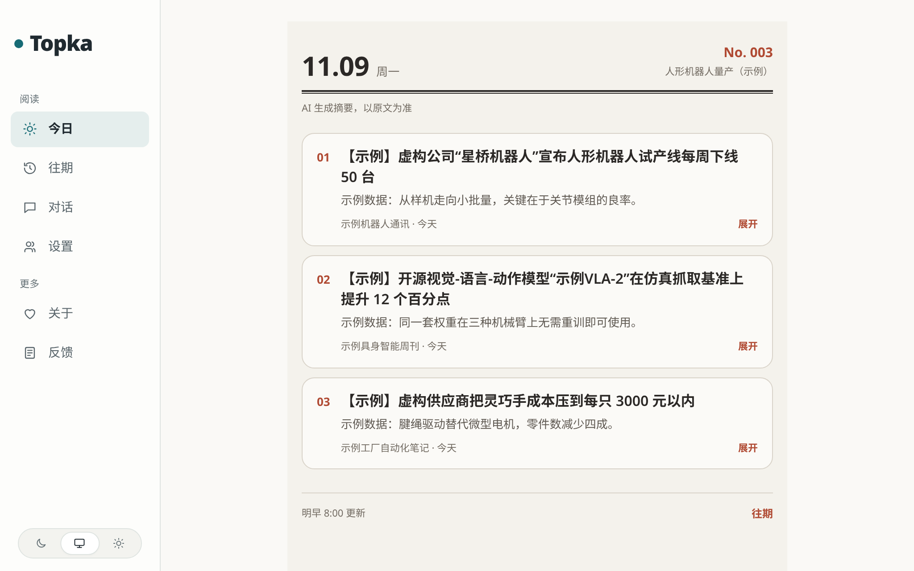
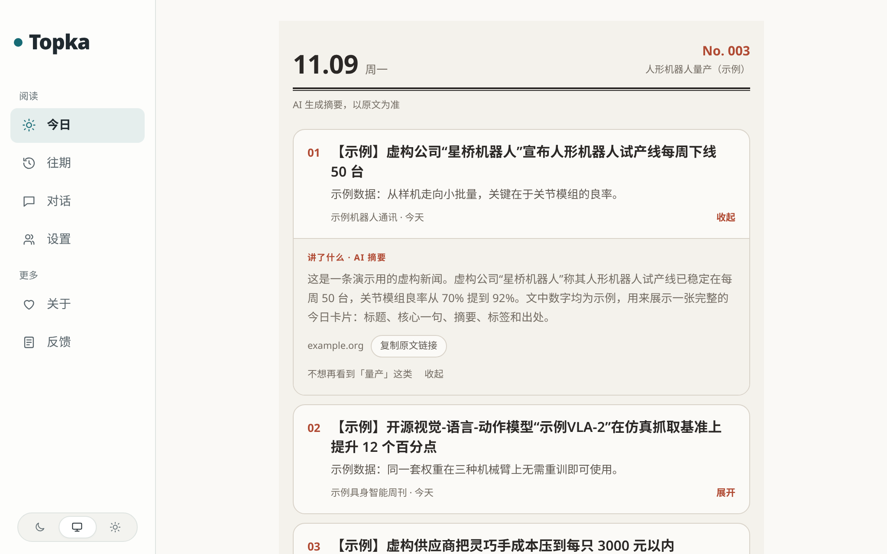
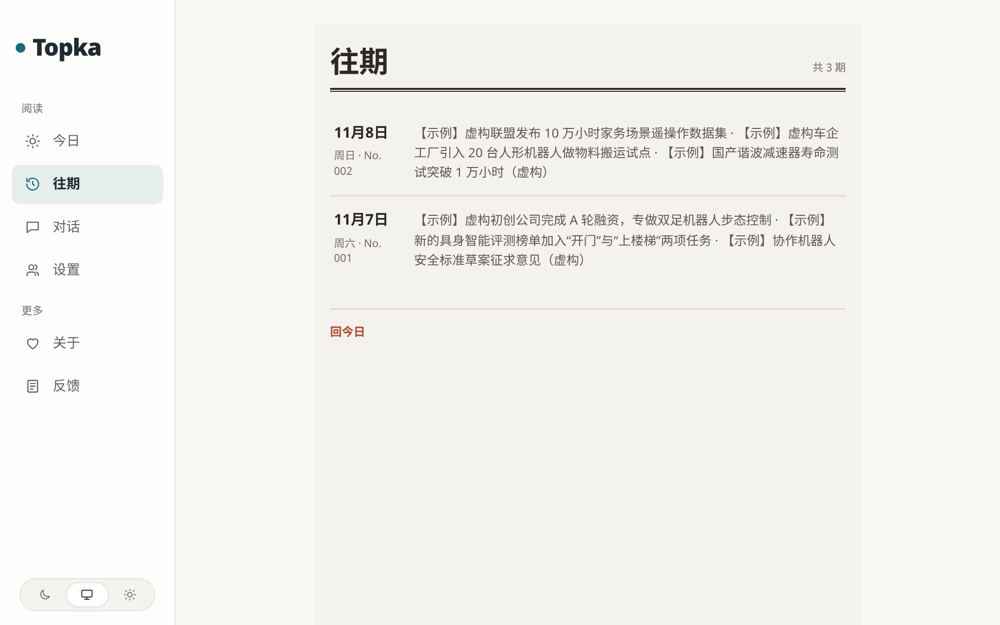

<div align="center">

**简体中文** · [English](README.en.md)

# Topka



> *「只告诉你变了什么。证据不够，就直说不够。」*

[](LICENSE)
[](CHANGELOG.md)
[](#先跑起来不要-api-key)
[](#接上真实信源和模型)

**一个自己部署的情报工作台：说清楚你要盯什么，它每天从你指定的信源里挑出最值得看的几条，每条都能点回原文。**

你告诉它「盯人形机器人量产」，它就围着这件事持续采集固定的一批信源，<br>
把不同来源对同一件事的报道合成一个事件，每天早上 8 点（UTC+8）定稿一期，默认最多三张卡片。<br>
够格的不到三条就少放几张，不拿凑数的内容填满。

```bash
git clone https://github.com/CyrusAurora/topka.git && cd topka
docker run --rm -u "$(id -u):$(id -g)" -v "$PWD:/app" -w /app node:24-trixie-slim node scripts/init-env.ts
DEMO_SEED=true docker compose up -d --build
```

<sub>三条命令启动，登录后就是上面那张图：用的是自带的虚构演示数据，不需要 API key，不抓任何网站，也不调用模型。</sub>

[看效果](#看效果) · [先跑起来](#先跑起来不要-api-key) · [接上真实信源和模型](#接上真实信源和模型) · [它怎么工作](#它怎么工作) · [诚实边界](#诚实边界) · [排错](#排错)

</div>

---

## 看效果

点开一张卡片，看到的是 AI 写的摘要、原文的出处，和一个复制原文链接的按钮：



过去每天的一期都留着，在「往期」里按天排开：



<sub>▲ 三张图都是从当前版本实际截的，用的是仓库自带的演示数据：信源、标题、数字全是虚构的，所以每个标题都以【示例】开头。照着[教程](docs/tutorial.md)跑，你看到的就是这三张图，只是日期换成你运行的那天。</sub>

日常用起来是这样：

| 你做什么 | Topka 做什么 |
|---|---|
| 建一个追踪项目，写下要盯什么、为什么盯 | 从你绑定的信源里持续采集，每篇文章先预筛，再由模型独立打两次分 |
| 什么都不做，第二天早上打开「今日」 | 每天 08:00（UTC+8）定稿当天一期，默认最多三张卡片（`TODAY_CARD_COUNT` 可设 3 到 5）；同一个信源最多占两张，够格的不够就少放 |
| 点开一张卡片 | 看摘要和出处，一键复制原文链接 |
| 在「对话」里问它 | 用你自己的模型 Key（BYOK）回答，不占实例的预算 |
| 想接到别的工具里 | 同一份内容也有 RSS 订阅、公开 JSON API（`/api/v1`）、MCP 接口（AI 助手可以直接来读的标准接口）和 `llms.txt`（写给大模型看的站点说明） |

---

## 先跑起来（不要 API key）

### 需要什么

- **Docker 和 Compose v2**（Docker 把程序连同它依赖的一切装进「容器」里运行；Compose 一条命令拉起一组容器）：`docker compose version` 能打出版本号就行。Topka 的数据库、后端、网页都跑在容器里，你的电脑上不用装 Node.js 或 PostgreSQL。
- **`git`**，和大约 **3 GB** 磁盘空间放镜像。2 核 4 GB 的机器就够。
- **本机的 3000 端口没被占用**。被占了的话，在每一条 `docker compose up` 前面加上 `PORT=127.0.0.1:3300`，然后打开 3300。站点默认只在本机能打开；要让别的机器访问，看 [docs/self-hosting.md 的 HTTPS 一节](docs/self-hosting.md#https-caddy-profile)。

不需要 API key，不需要 GPU，也不需要注册任何账号。

### 三步

**1. 拿代码，生成配置文件 `.env`**

```bash
git clone https://github.com/CyrusAurora/topka.git && cd topka
docker run --rm -u "$(id -u):$(id -g)" -v "$PWD:/app" -w /app node:24-trixie-slim node scripts/init-env.ts
```

第二条命令在一个用完即删的 Node 容器里生成 `.env`，里面是随机生成的各种密钥。它会打印：

```text
已生成 .env。
管理员密码：（一串随机字符）（也写在 .env 的 ADMIN_PASSWORD 里）
还差一步：在 .env 里填上 LLM_API_KEY（以及 LLM_BASE_URL、LLM_MODEL，默认是 DeepSeek）。
```

最后一行先**不用管**：看演示用不到模型。

**2. 带着演示数据启动**

```bash
DEMO_SEED=true docker compose up -d --build
```

第一次要构建镜像，按网速大概 5 到 15 分钟；以后再启动只要几秒。它会起一个 PostgreSQL 数据库，跑一遍数据库迁移，然后写入演示数据：一个读者账号、一个追踪项目「人形机器人量产（示例）」、三天的虚构卡片。

**3. 拿到演示账号的密码，登录**

```bash
docker compose logs setup | grep demo:
```

```text
setup-1  | demo: ready. Log in at /login as demo@example.com
setup-1  | demo: password demo-1be4ef872d6d  (shown once; set DEMO_PASSWORD and re-run to reset it)
```

密码是随机的，每个人不一样，而且只在这里出现一次，先记下来。打开 <http://localhost:3000/login>，用 `demo@example.com` 和这个密码登录。

### 看到这些就成了

- 「今日」显示 **No. 003**，三张编号卡片，标题都以【示例】开头，和本页最上面那张图一样。
- 点卡片标题能展开摘要；左边「往期」里有前两天的两期。
- 后台在 <http://localhost:3000/admin>，用 `.env` 里的 `ADMIN_PASSWORD` 登录。

没出来的话看[排错](#排错)。想再往下走一步，让它抓真实的文章（还是不用模型），看[教程第二部分](docs/tutorial.md#第二部分接两个真实信源仍然不用模型-key)。

不玩了，一条命令删干净（连数据库一起）：

```bash
docker compose down -v
```

---

## 接上真实信源和模型

演示数据不会自己变。要让它每天真的出新的一期，需要两样东西：**打开几个信源**，和**接上一个模型**。两样默认都是关的，这是故意的：没你点头，它不抓任何网站，也不花一分钱。

**信源。** 仓库自带大约 400 个信源，启动时全部导入，但全部是关的。在后台 `/admin/sources` 里打开你要的，或者用命令只打开指定的几个：

```bash
docker compose exec api npm run sources:only -- --id rss-hugging-face --id rss-github-ai
```

**模型。** 打分、写摘要、归并事件都要调用大模型。Topka 支持任何「OpenAI 兼容」的接口，也就是大多数模型厂商都提供的那种标准格式。你需要在 `.env` 里填三项：

```bash
LLM_BASE_URL=https://api.deepseek.com/v1   # 模型厂商的接口地址
LLM_API_KEY=sk-...                        # 你在厂商后台申请的 API key，相当于调用模型的密码
LLM_MODEL=deepseek-flash                  # 用哪个模型
```

不想花钱，可以只用免费模型：比如接 OpenRouter，在 `LLM_FREE_MODELS` 里列几个带 `:free` 的模型，它调用前先去 OpenRouter 核对报价，每一项都是 0 才用；免费的都用不了时就停下来等，不会自己换成收费模型。几种免费路线的区别见 [docs/self-hosting.md#model-connection](docs/self-hosting.md#model-connection)。

最后把两个总开关打开，重启：

```bash
sed -i 's/^COLLECT_ENABLED=false/COLLECT_ENABLED=true/; s/^MODEL_CALLS_ENABLED=false/MODEL_CALLS_ENABLED=true/' .env
docker compose up -d
```

**BYOK** 是 bring your own key 的缩写，意思是「自带 Key」。这里有两层：上面填的是**实例 Key**，跑所有后台任务，费用记在部署的人账上；注册的读者也可以在「设置」里填自己的 Key，「对话」就用他自己的额度，不占实例的预算。

每一次付费调用都记一张回执，并且有每分钟、每小时、每天三道预算熔断，超了就停。

完整的部署说明（HTTPS、备份、升级、多个读者、免费模型怎么选）在 [docs/self-hosting.md](docs/self-hosting.md)，每个配置项的说明在 [docs/configuration.md](docs/configuration.md)。

---

## 它怎么工作

```
信源（RSS / 网页列表 / JSON / X / 公众号 / 推送接口）
   │  worker 定时采集，判重
   ▼
预筛 ──▶ 独立打两次分 ──▶ 写标题和摘要 ──▶ 结构化抽取 ──▶ 合并成事件
   │                                   （全部在 worker 里跑，读者打开页面不会触发模型调用）
   ▼
每个追踪项目按相关度挑选 ──▶ 每天 08:00 UTC+8 定稿一期（最多三张，同一信源最多两张）
   │
   ▼
网站「今日 / 往期」· RSS · /api/v1 · MCP · llms.txt   （都读同一个公开读取层）
```

- **六种信源，一条流水线**：RSS/Atom、网页列表（用 CSS 选择器取条目）、JSON 接口、X 账号、微信公众号（经第三方接口）、外部推送接口。
- **编辑标准写在提示词里**：预筛、打分、标题和摘要的风格都是 `industry/` 里的提示词，门槛按信源分级，能按行业改。
- **按项目打分不增加模型调用**：多一个追踪项目，不会让每篇文章多调一次模型。
- **换行业只改一个目录**：站名、分类、主题、示例信源、提示词、门槛、品牌和条款页都在 `industry/`，默认是 AI 行业。步骤见 [docs/customize.md](docs/customize.md)。

各部分怎么拼在一起，有图，见 [docs/architecture.md](docs/architecture.md)。

---

## 诚实边界

- **界面和生成的内容以中文为主**，还没做多语言。
- **默认不转载全文**：站内只放摘要和原文链接。只有来源明确允许的信源，才能逐个打开全文（`site_fulltext`）。
- **单机部署**，数据库是 PostgreSQL，没有多节点或横向扩容。
- **卡片的质量取决于你接的模型和信源。** 演示数据是手写的；接上真实模型后，摘要由模型根据原文写，可能出错，所以今日页顶上写着「AI 生成摘要，以原文为准」。
- **定稿时间固定在 08:00 UTC+8**，目前不能改。当天没有够格的内容，那一期就是空的，过了 08:00 不会补。
- **目前只有一位维护者**，尽力而为，不承诺 SLA（服务等级承诺，比如多久内回复、多久内修好），具体见 [SUPPORT.md](SUPPORT.md)；安全漏洞的报告方式见 [SECURITY.md](SECURITY.md)。

---

## 排错

| 症状 | 原因 | 处理 |
|---|---|---|
| `required variable POSTGRES_PASSWORD is missing a value` | 还没生成 `.env` | 先跑第 1 步的 `init-env` |
| `Bind for …:3000 failed: port is already allocated` | 本机别的程序在用 3000 | 每条 `docker compose up` 前面加 `PORT=127.0.0.1:3300`，打开 3300 |
| `logs setup` 里找不到 `demo:` 那两行 | 启动时没带 `DEMO_SEED=true` | `docker compose exec api npm run demo:seed`，会补上演示数据并打印密码 |
| 演示密码丢了 | 密码只在第一次打印；改了 `.env` 再重启后，`setup` 的日志也会被清掉 | 在 `.env` 里加 `DEMO_PASSWORD=至少10个字符`，再跑 `docker compose exec api npm run demo:seed` |
| `demo:seed` 拒绝运行 | 数据库里已经有别的用户或真实文章，演示数据不往里掺 | 确定要掺就加 `-- --force`；或者 `docker compose down -v` 从头来 |
| 在容器里跑 `npm run` 先打出 `.env not found. Continuing without it.` | 容器里的配置来自 Compose，不读文件 | 正常现象，不用处理 |
| 打开了信源，几分钟后还是没有新文章 | `COLLECT_ENABLED` 还是 `false`，或者改完没重启 | 改成 `true`，再跑 `docker compose up -d`；抓取失败的原因在 `/admin/sources` |
| 有文章了，但没有新卡片 | 模型没接上或 `MODEL_CALLS_ENABLED=false`；文章只采集不分析 | 见[接上真实信源和模型](#接上真实信源和模型)；日志里搜 `is not configured` |

更多（日志里的 `NO_FREE_MODEL`、`FREE_MODEL_ALERT`，国内服务器怎么连海外信源）见 [docs/self-hosting.md#troubleshooting](docs/self-hosting.md#troubleshooting)。

---

## 文档

从[教程](docs/tutorial.md)开始（[English](docs/tutorial.en.md)）。全部文档的索引在 [docs/README.md](docs/README.md)，常看的：[自部署](docs/self-hosting.md) · [配置项](docs/configuration.md) · [架构](docs/architecture.md) · [换行业定制](docs/customize.md) · [信源](docs/sources.md) · [精选与校准](docs/selection.md) · [插件](docs/plugins.md)。

除教程和本页之外，文档目前是英文。

## 参与贡献

开发环境、命令和约定见 [CONTRIBUTING.md](CONTRIBUTING.md)；参与即同意遵守[行为准则](CODE_OF_CONDUCT.md)。欢迎 issue 和 pull request。

项目怎么运转都写下来了：[GOVERNANCE.md](GOVERNANCE.md)（谁决定什么）、[MAINTAINERS.md](MAINTAINERS.md)（谁负责哪块）、[SUPPORT.md](SUPPORT.md)（能得到什么帮助）、[TRADEMARK.md](TRADEMARK.md)（许可证管代码，不管名字）。

## 许可与致谢

MIT，见 [LICENSE](LICENSE)。

Topka 是 MIT 许可的 AIHOT 框架（<https://github.com/KKKKhazix/AIHOT>，上游快照 2026-09-28）的 fork，也就是在它的代码基础上改出来的独立项目，谢谢上游作者。AIHOT 的名称和 Logo 不在授权范围内，这里也没有使用；署名和第三方声明见 [NOTICE](NOTICE)。
