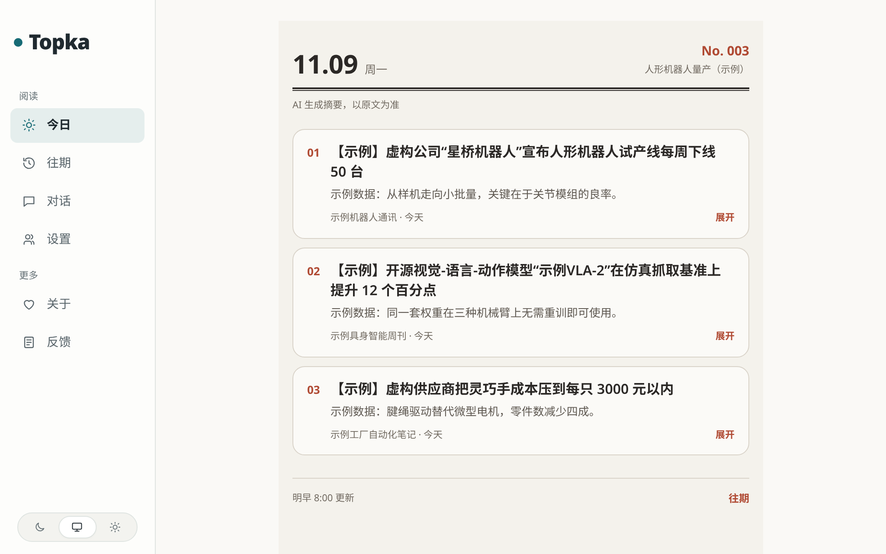
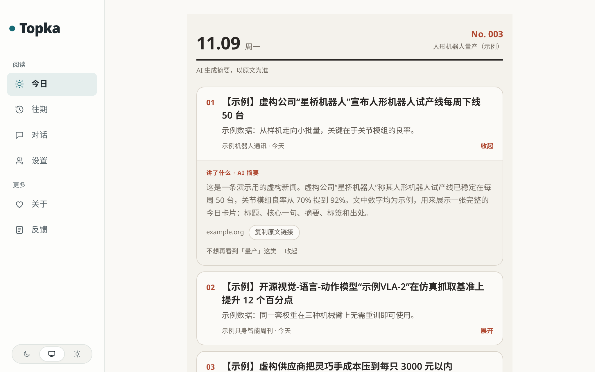
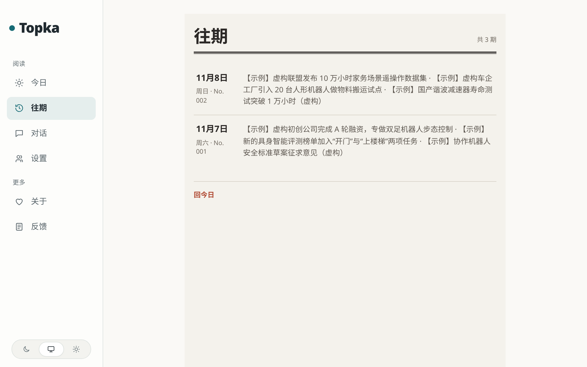
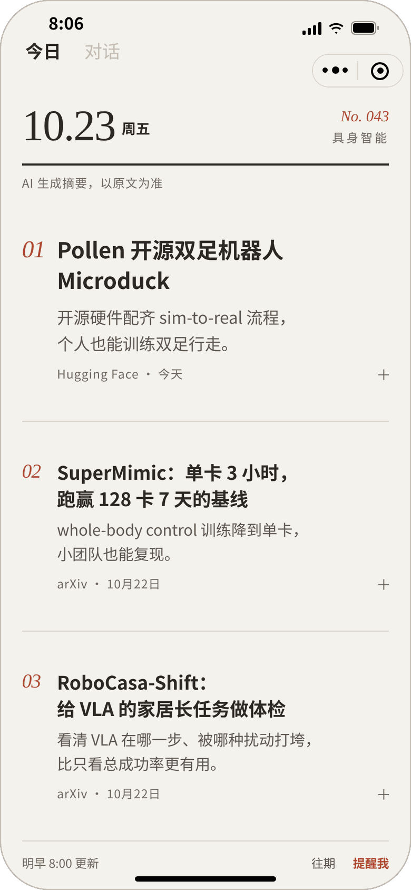
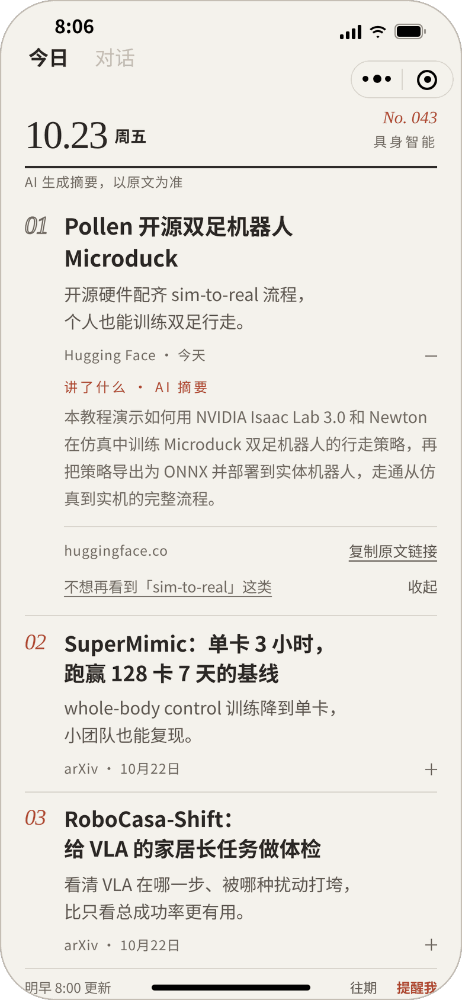
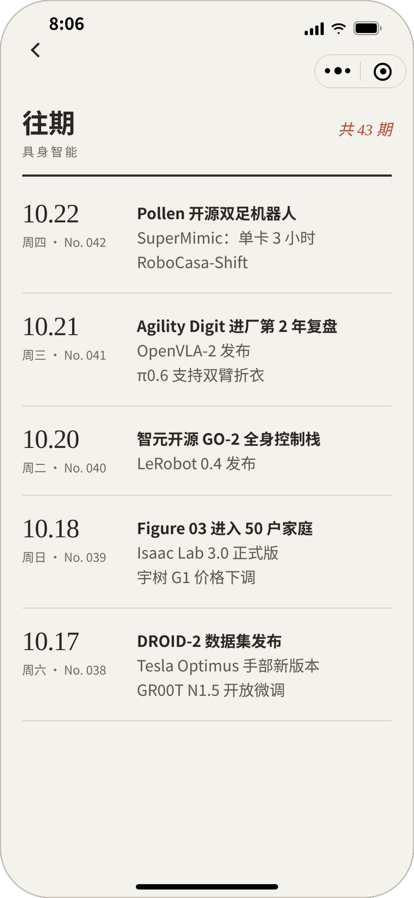
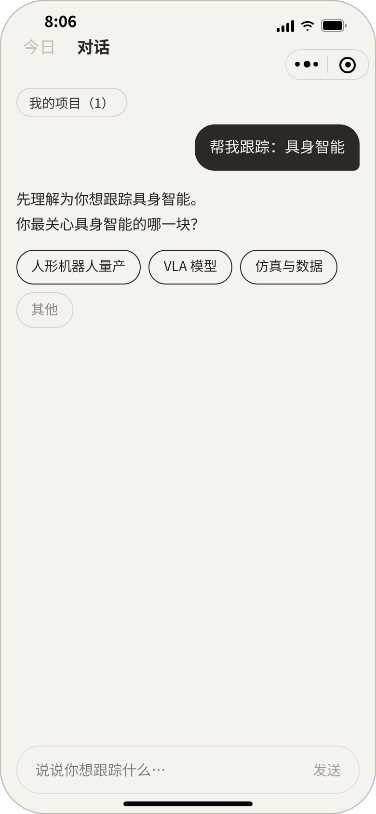
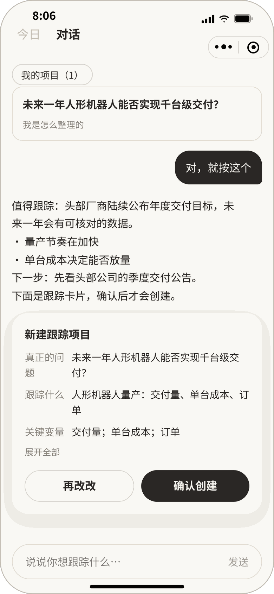
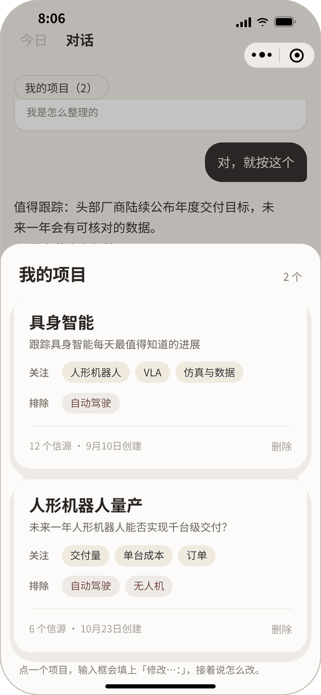

<div align="center">

**简体中文** · [English](README.en.md)

# Topka



> *「只告诉你变了什么。不够格就少发或空一期，宁少不凑。」*

[](LICENSE)
[](CHANGELOG.md)
[](#先跑起来)
[](#接上真实信源和模型)

**说清楚你要盯什么，Topka 每天早上 8 点从你的信源里挑出最多 3 条最值得看的内容，每条都能点回原文。**

**[在线体验 →](https://cyrusaurora.github.io/topka/)**

<!-- doc-test: run quickstart; timeout 1800 -->
```bash
git clone https://github.com/CyrusAurora/topka.git && cd topka
docker run --rm -u "$(id -u):$(id -g)" -v "$PWD:/app" -w /app node:26-trixie-slim node scripts/init-env.ts --demo
docker compose up -d --build
```

<sub>自带演示数据和演示模型，不要 API key。</sub>

[先跑起来](#先跑起来) · [接上真实信源和模型](#接上真实信源和模型) · [它怎么工作](#它怎么工作) · [排错](#排错)

</div>

---

## 看效果

点开一张卡片，看摘要、出处，复制原文链接：



每一期都留在「往期」里：



做成微信小程序或手机 App，是这样：

<table>
<tr>
<td align="center" width="33%"><br><sub>今日三条</sub></td>
<td align="center" width="33%"><br><sub>点开看摘要，复制原文链接</sub></td>
<td align="center" width="33%"><br><sub>往期</sub></td>
</tr>
<tr>
<td align="center" width="33%"><br><sub>说想盯什么，点选项回答</sub></td>
<td align="center" width="33%"><br><sub>确认卡片，项目就建好了</sub></td>
<td align="center" width="33%"><br><sub>我的项目：关注什么、排除什么</sub></td>
</tr>
</table>

---

## 先跑起来

需要 Docker Compose v2、`git` 和约 3 GB 磁盘，2 核 4 GB 的机器就够。网站默认开在本机 3000 端口。

**1. 克隆，生成 `.env`**

<!-- doc-test: skip the quick start block above runs these same commands -->
```bash
git clone https://github.com/CyrusAurora/topka.git && cd topka
docker run --rm -u "$(id -u):$(id -g)" -v "$PWD:/app" -w /app node:26-trixie-slim node scripts/init-env.ts --demo
```

终端会打印网站地址和管理员密码。3000 端口被占的话，在这条命令末尾加 `--port 127.0.0.1:3300`，端口只在 `.env` 的 `PORT` 一处设置。

**2. 启动**

<!-- doc-test: skip the quick start block above runs these same commands -->
```bash
docker compose up -d --build
```

第一次构建要半分钟到十几分钟。检查是否起来了：

<!-- doc-test: run quickstart; retry 180; expect "ok":true -->
```bash
curl -s "http://$(docker compose port web 3000)/api/health"   # {"app":"topka",…,"ok":true,"db":"ok",…}
```

**3. 登录**

<!-- doc-test: run quickstart; retry 180; expect demo: ready -->
```bash
docker compose logs setup | grep demo:
```

```text
setup-1  | demo: ready. Log in at /login as demo@example.com
setup-1  | demo: password demo-1be4ef872d6d  (shown once; to reset it: add DEMO_PASSWORD=<10+ characters> to .env, run `docker compose up -d`, then `docker compose exec api npm run demo:seed`)
```

打开 <http://localhost:3000/login>，用 `demo@example.com` 和上面的密码登录。你会看到：

- 「今日」是 No. 003，三张【示例】卡片
- 「往期」里有前两期
- 「对话」里说一句想盯什么，回答两三个问题，确认后项目就建好了
- 后台在 `/admin`，密码是 `.env` 里的 `ADMIN_PASSWORD`

想抓真实文章但先不接模型，看[教程第二部分](docs/tutorial.md#第二部分接两个真实信源仍然不用模型-key)。

<!-- doc-test: run quickstart; defer -->
```bash
docker compose down -v   # 删掉容器和数据
```

---

## 接上真实信源和模型

每天出新一期，要打开信源、接上模型。两样默认都关着。

**信源。** 仓库自带三百多个信源，在 `/admin/sources` 里打开，或者：

<!-- doc-test: run quickstart; expect 2 -->
```bash
docker compose exec api npm run sources:only -- --id rss-hugging-face --id rss-github-ai
```

**模型。** 任意 OpenAI 兼容接口，填进 `.env`：

<!-- doc-test: skip lines for .env with placeholder values, not commands -->
```bash
LLM_BASE_URL=https://api.deepseek.com/v1
LLM_API_KEY=sk-...
LLM_MODEL=deepseek-flash
```

不想花钱，有两种接法，配置见 [Without a paid key](docs/self-hosting.md#without-a-paid-key)：

- **本地 Ollama**：`COMPOSE_PROFILES=ollama`，再 `docker compose exec ollama ollama pull qwen2.5:7b`。最好有 GPU。
- **OpenRouter `:free` 模型**：在 `LLM_FREE_MODELS` 里列出模型，只用报价为 0 的。

然后打开采集和模型调用：

<!-- doc-test: skip turns on collection and model calls, which reach outside services; CI makes no outside calls -->
```bash
sed -i 's/^COLLECT_ENABLED=false/COLLECT_ENABLED=true/; s/^MODEL_CALLS_ENABLED=false/MODEL_CALLS_ENABLED=true/' .env
docker compose up -d
```

读者也可以在「设置」里填自己的 Key（BYOK），对话就走他们自己的额度。每次付费调用都有记录，超过每分钟、每小时、每天的预算会自动停。

完整部署见 [docs/self-hosting.md](docs/self-hosting.md)，配置项见 [docs/configuration.md](docs/configuration.md)。

---

## 它怎么工作

```
信源（RSS / 网页列表 / JSON / X / 公众号 / 推送）
   │  定时采集、去重
   ▼
预筛 → 两次独立打分 → 写标题和摘要 → 合并成事件
   │
   ▼
按你的项目挑选 → 每天在你的时区 08:00 定稿（最多 3 条，同一信源最多 2 条）
   │
   ▼
网站「今日 / 往期」· 你自己的订阅源（Atom）
```

- 打分和写作的提示词在 `industry/`，默认是 AI 行业。换行业只改这个目录，见 [docs/customize.md](docs/customize.md)
- 建项目时可以按地区挑信源（`global` / `cn` / `us` / `eu` / `jp`）
- 界面有简体中文和 English，每位读者自己选语言和时区
- 只放摘要和原文链接，不转载全文

架构见 [docs/architecture.md](docs/architecture.md)。

---

## 排错

| 症状 | 处理 |
|---|---|
| `required variable POSTGRES_PASSWORD is missing a value` | 先跑第 1 步的 `init-env` |
| `Bind for …:3000 failed: port is already allocated` | `.env` 里改 `PORT=127.0.0.1:3300`，再 `docker compose up -d` |
| `curl …/api/health` 返回的不是 Topka | 用 `curl -s "http://$(docker compose port web 3000)/api/health"` |
| `logs setup` 里没有 `demo:` | `.env` 里设 `DEMO_SEED=true`，再 `docker compose up -d` |
| 演示密码丢了 | `.env` 加 `DEMO_PASSWORD=至少10个字符`，`docker compose up -d`，再 `docker compose exec api npm run demo:seed` |
| `docker compose logs` 每行带 `ESC[2K` | 直接读容器日志：`docker logs $(docker compose ps -aq setup)` |
| 打开了信源，几分钟没有新文章 | `.env` 里 `COLLECT_ENABLED=true`，再 `docker compose up -d`；失败原因在 `/admin/sources` |
| 有文章但没有新卡片 | 接上模型并设 `MODEL_CALLS_ENABLED=true`；日志里搜 `is not configured` |

更多见 [troubleshooting](docs/self-hosting.md#troubleshooting)。

---

## 文档

[教程](docs/tutorial.md)（[English](docs/tutorial.en.md)）· [文档索引](docs/README.md) · [自部署](docs/self-hosting.md) · [配置](docs/configuration.md) · [换行业](docs/customize.md) · [信源](docs/sources.md) · [贡献](CONTRIBUTING.md) · [安全](SECURITY.md)

## 许可

MIT，见 [LICENSE](LICENSE)。

感谢 [AIHOT](https://github.com/KKKKhazix/AIHOT)。
