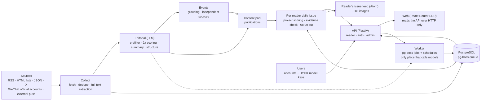
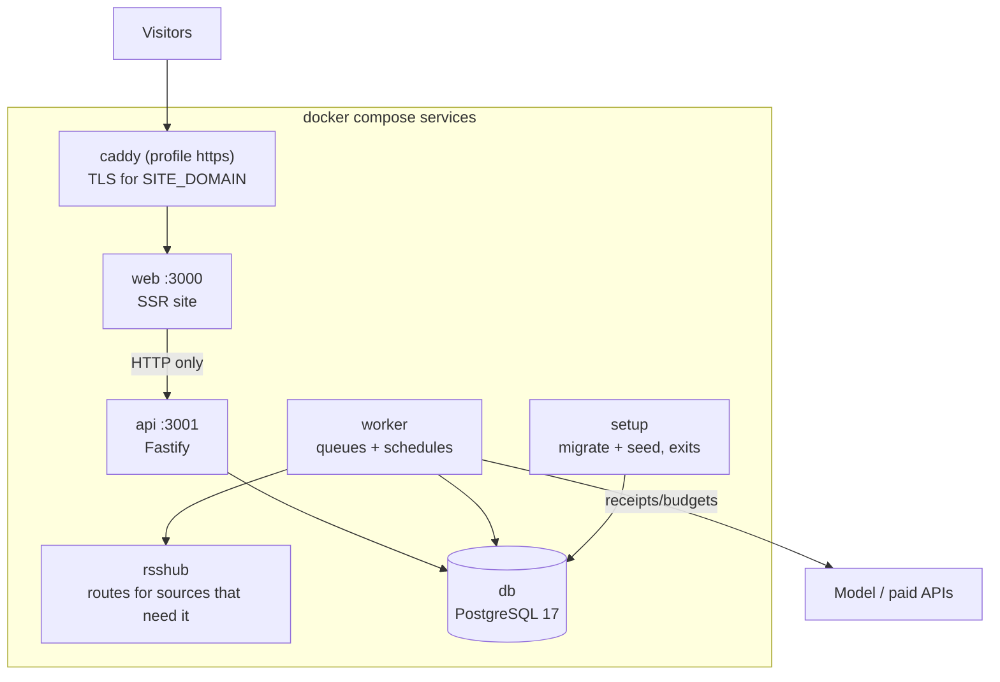

# Architecture

## Data flow



Money-touching path: every request to a paid service (models, X, WeChat official accounts, Jina)
is checked against per-minute / per-hour / per-day budgets first, then recorded as a receipt, and
the response is stored before use — a retried job reuses the paid result instead of paying twice
(`packages/backend/src/providers/receipts.ts`).

## Process layout

Everything talks to the same database; each role runs in its own container in the default
`docker compose` deployment:



Production without Docker runs three long-lived processes from one checkout: `apps/api/src/main.ts`
(3001), `apps/worker/src/main.ts`, and `apps/web/server.ts` (3000) — see
[docs/self-hosting.md](self-hosting.md).

## The three processes

| Process | Code | What it does |
|---|---|---|
| api | `apps/api/` | Fastify. Reader endpoints (`/api/me/…`: today, issues, projects, chat, keys), auth, the about and feedback pages' `/api/site/…`, the reader's issue feed, admin endpoints, image proxy, OG images |
| worker | `apps/worker/` | pg-boss job queues and cron schedules: collect sources, run model jobs, group events, score items per project, alerts, backups, cleanup |
| web | `apps/web/` | React Router, server-side rendered. Reads the api **only over HTTP**; never touches the database |

Domain logic lives in `packages/backend/` (sources, ingest, editorial/LLM, events, projects and
issues, publication, accounts, providers); shared types and constants in
`packages/contracts/`; everything industry-specific in `industry/`.

## Invariants worth keeping

These rules are what makes the system safe to extend (they are the same rules given to coding
agents in [AGENTS.md](../AGENTS.md)):

- **One publishing model.** What a reader sees is their daily issue (`user_issues`,
  `user_issue_items`), cut from the publication pool (`packages/backend/src/publication/`) by
  `packages/backend/src/projects/issues.ts`. The web, the issue feed and the demo export all show
  that issue; a new outlet reads it too.
- **Page views never call models.** A reader's page load reads database state only. Model calls
  happen exclusively in worker jobs (`apps/worker/`, pg-boss), so a page view costs nothing.
- **Paid requests go through receipts and budgets.** No direct provider calls outside the
  providers layer; receipts record cost and reused results; budgets are circuit breakers per
  service (`/admin` → Settings → Budget).
- **Safety valves default off.** `COLLECT_ENABLED`, `MODEL_CALLS_ENABLED`, `FEISHU_*_ENABLED`
  control whether anything is *sent out*, not which code path runs.
  Development and tests keep them off; tests never hit external services (local stubs serve every
  provider).
- **BYOK keys stay encrypted at rest.** Per-user model keys (`/api/me/keys`, migration 0052) are
  AES-256-GCM encrypted with `KEY_ENCRYPTION_SECRET`; the API returns only the last 4 characters.
- **Frontend is HTTP-only.** `apps/web` reads `apps/api` over HTTP; database access, model calls
  and secrets exist only in the backend apps.
- **Readers see only their own.** Issues, projects and chat belong to the signed-in reader; the
  admin UI is admin-only.
- **Migrations are append-only.** `database/migrations/*.sql` run in name order in their own
  transactions; edits only append new files. See `scripts/migrate.ts`.
- **Old material never floods "Today".** Items published more than 48 hours before discovery,
  fresh-import backfills, and batch pushes are archived by original publish time: they never
  enter "Today" and never push a notification.
- **Observations are append-only.** `articles` and `article_revisions` refuse UPDATE/DELETE
  (`0059`); every write answers `created` / `existing` / `conflict` / `failed`, refusals and
  withdrawals are their own records, and a project brief is confirmed only through the checkpoint
  decision table in `packages/contracts/src/brief.ts`. See [ledger.md](ledger.md).
- **Leads are not evidence.** Discovery signals (`discovery_signals`) are promoted only when a saved
  editorial observation has the same URL identity (pure gate in `packages/contracts/src/discovery.ts`);
  they never enter briefs or issues. See [discovery.md](discovery.md).
- **Source traceability.** Every selected item links to the original; full-text display is
  per-source (`site_fulltext`), default off.

## Directory map

| Location | Contents |
|---|---|
| `industry/` | Industry pack: site copy, taxonomy, demo sources, prompts, thresholds, brand, legal pages |
| `packages/backend/src/sources/` | Readers for the six source kinds; collect scheduling (`collect.ts`) |
| `packages/backend/src/content/` | Ingest, dedupe, full-text extraction and cleaning |
| `packages/backend/src/editorial/` | Judging and writing: `analyze.ts` (flow), `prompts.ts` (loads prompts), `models.ts` (per-step model routing) |
| `packages/backend/src/events/` | Event grouping and source independence |
| `packages/backend/src/projects/` | Tracking projects: baselines, per-project scoring, checkpoint revisit, today views, per-user issues; the evidence check that leaves weak candidates out (`evidence.ts`, logged in `issue_abstentions`) |
| `packages/backend/src/accounts/` | Invites, sessions, per-user keys (BYOK) |
| `packages/backend/src/jobs/` | pg-boss queue, job registrations |
| `packages/backend/src/publication/` | The publication pool and its release gate |
| `packages/backend/src/notify/` | Alert and feedback webhooks |
| `packages/backend/src/operations/` | Alerts, backups, retention |
| `packages/backend/src/admin/` | Admin endpoints |
| `packages/backend/src/quality/` | Quality evals: metrics, replays and the report `npm run eval` prints ([quality.md](quality.md)) |
| `packages/backend/src/providers/` | Model, embedding, X, WeChat official accounts (via third-party API), Jina clients; receipts and budgets |
| `apps/web/app/routes/` | One file per page; `routes.ts` is the route table |
| `database/migrations/` | Append-only SQL migrations |
| `scripts/` | Init, migration, seed, evaluation, checks |
| `eval/` | Labelled sets, runtime snapshot and thresholds for the quality evals |
| `tests/` | Backend tests (need an empty database named `…_test` or `…_ci`) |
| `database/seeds/` | Seed data the migrations and `scripts/seed.ts` load |
| `deploy/` | Reverse-proxy example (Caddy); `docker-compose.yml` at the root is the supported stack |
| `examples/` | Example plugin ([plugins.md](plugins.md)) |
| `packages/backend/src/plugins.ts`, `providers/chat-routes.ts` | Plugin loader (`TOPKA_PLUGINS`) and the interactive chat route API |

## Reader-facing routes

| Route | Contents |
|---|---|
| `/` `/today` | Today's issue (signed in), or the sign-in page |
| `/archive` `/issue/:date` | Past issues |
| `/projects` `/projects/:projectId` `/projects/new` | Tracking projects and their briefs |
| `/chat` `/settings` | The project assistant; language, time zone, BYOK keys, issue feed |
| `/feed/issue/<token>.xml` | The reader's own issue feed (Atom), created in Settings |
| `/about` `/feedback` | About the site, feedback form |
| `/api/health` | Health check for monitoring |
| `/admin` | Admin UI |

The inherited public pages (`/all`, `/hot`, `/topics`, `/daily`, `/weekly`, `/monthly`, `/leaderboard`, …)
redirect to `/` or `/archive`; the old public machine exits (`/api/v1`, `/api/mcp`, `/feed.xml`,
`/sitemap.xml`, `/llms.txt`) answer 410.

## Verification

<!-- doc-test: skip needs a local PostgreSQL you can run createdb on; the Check job runs each of these commands -->
```bash
npm run typecheck
createdb topka_test
DATABASE_URL=postgres://127.0.0.1:5432/topka_test node scripts/migrate.ts
DATABASE_URL=postgres://127.0.0.1:5432/topka_test npm test
npm run eval -- --check                     # quality evals, offline (docs/quality.md)
npm run build -w @topka/web && node --test apps/web/tests/*.test.ts
docker compose exec web node scripts/smoke.ts --base http://localhost:3000   # with the Docker stack running
```
