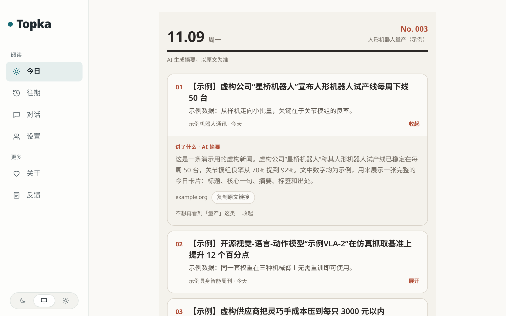

# Tutorial: from an empty machine to the first card on screen

**English** · [简体中文](tutorial.md)

Run Topka on your own machine and see a daily issue. No API key or GPU; about 30 minutes, most of it the
first image build.

- **Part 1**: run it with the demo data that ships with the repository.
- **Part 2**: switch on two real RSS feeds and watch articles arrive.
- **Part 3**: create your own tracking project, then connect a free model (optional).

HTTPS, backups and upgrades: [self-hosting.md](self-hosting.md).

## What you need

- **Docker with Compose v2**: `docker compose version` prints a version. No Node.js or PostgreSQL on the host.
- **`git`**.
- **About 3 GB of free disk**. A 2-core / 4 GB machine is enough.
- **A free port**, 3000 by default, set in `PORT` in `.env`. If 3000 is taken, add
  `--port 127.0.0.1:3300` to step 1's `init-env.ts` command and open 3300 wherever this page says 3000.
  The site opens on this machine only; for other machines see [HTTPS](self-hosting.md#https-caddy-profile).

The site and the demo content default to Chinese. Add `--locale en` to step 1's `init-env.ts` for an
English site and English demo stories (the screenshots show the Chinese default).

## Part 1: the demo site

### 1. Get the code and generate `.env`

<!-- doc-test: run quickstart -->
```bash
git clone https://github.com/CyrusAurora/topka.git && cd topka
docker run --rm -u "$(id -u):$(id -g)" -v "$PWD:/app" -w /app node:26-trixie-slim node scripts/init-env.ts --demo
```

The second command writes `.env` from a throwaway Node container, with random passwords and keys.
`--demo` switches the demo data on. It prints (in English with `--locale en`):

```text
已生成 .env。网站地址：http://localhost:3000（改端口就改 .env 里的 PORT）
管理员密码：<random>（也写在 .env 的 ADMIN_PASSWORD 里）
演示：DEMO_SEED=true，启动时写入演示数据；没接模型时「对话」由内置演示模型回答。
模型：LLM_API_KEY 还空着。接免费模型或本地 Ollama 见 docs/self-hosting.md#model-connection。
```

That is the site address, the admin password, the demo switch and a note that no model key is set yet
(ignore it for now). Running it again never overwrites an existing `.env`.

### 2. Start with the demo content

<!-- doc-test: run quickstart; timeout 1800 -->
```bash
docker compose up -d --build
```

The first build takes from half a minute to a quarter of an hour; later starts take seconds. It ends
with lines like:

```text
 Container topka-api-1  Started
 Container topka-worker-1  Started
 Container topka-web-1  Started
```

The `setup` container migrates the database, imports the sources and four project packs (all switched
off), and writes the demo:

- a reader account `demo@example.com`,
- one tracking project, "人形机器人量产（示例）" (humanoid robot mass production, example),
- three invented sources (`https://example.org/...` addresses, never fetched),
- nine invented stories: three in today's issue and three in each of the two previous days.

Check that it answers:

<!-- doc-test: run quickstart; retry 180; expect "ok":true -->
```bash
curl -s "http://$(docker compose port web 3000)/api/health"
```

```text
{"app":"topka","version":"1.0.0","ok":true,"db":"ok","ms":1,"release":"1.0.0"}
```

Right after start the answer can be empty; wait a few seconds.

### 3. Read the demo password

It is printed once, when the account is created:

<!-- doc-test: run quickstart; retry 180; expect demo: ready -->
```bash
docker compose logs setup | grep demo:
```

```text
setup-1  | demo: ready. Log in at /login as demo@example.com
setup-1  | demo: password demo-1be4ef872d6d  (shown once; to reset it: add DEMO_PASSWORD=<10+ characters> to .env, run `docker compose up -d`, then `docker compose exec api npm run demo:seed`)
setup-1  | demo: project project:h7e5…, issues written for 2026-11-07, 2026-11-08 and 2026-11-09
```

**Write the password down now**: after the restart in part 2 these lines are gone.

To choose your own password:

<!-- doc-test: run quickstart; retry 120; expect demo: password -->
```bash
echo 'DEMO_PASSWORD=at-least-10-chars' >> .env
docker compose up -d
docker compose exec api npm run demo:seed     # prints demo: password … (from DEMO_PASSWORD)
```

For one run only: `docker compose exec -e DEMO_PASSWORD=at-least-10-chars api npm run demo:seed`. If
`.env` also has a `DEMO_PASSWORD`, the next `docker compose up -d` runs `setup`, which
sets the password back to the `.env` value.

### 4. Log in and look

Open <http://localhost:3000/login> and sign in as `demo@example.com`.

- **今日** (Today): issue No. 003, three cards, every title starting with `【示例】` ("example").
- **Click a title**: the summary, the source and a button to copy the original link.
- **往期** (Archive): the two earlier issues.
- **The project page**: in 设置 (Settings), open "人形机器人量产（示例）".



Settings switches the interface to English and sets your time zone; your issue is fixed at 08:00 there
(default Asia/Shanghai). The admin is at <http://localhost:3000/admin>, password `ADMIN_PASSWORD` in
`.env`. Collection and model calls are off, so tomorrow brings no new issue: go on to part 2.

## Part 2: real articles, still no model key

Collect from two real RSS feeds. With the model still off, articles arrive but no new cards appear.

**1. Switch on two sources** (all others off):

<!-- doc-test: run quickstart -->
```bash
docker compose exec api npm run sources:only -- --id rss-hugging-face --id rss-github-ai
```

The output:

```text
保持打开 2 个（新打开 2），关闭其余 3 个
```

"Kept 2 on (2 newly on), switched 3 others off": the 3 are the demo sources. Every source is listed at
<http://localhost:3000/admin/sources>, or with `docker compose exec api npm run sources:list`.

**2. Turn collection on and restart:**

<!-- doc-test: skip turns on collection, so the worker fetches real feeds from the internet; CI makes no outside calls -->
```bash
sed -i 's/^COLLECT_ENABLED=false/COLLECT_ENABLED=true/' .env
docker compose up -d
```

**3. Watch it work, within a few minutes:**

- **`/admin/sources`**: the two sources at the top, with their last fetch and 7-day item count.
- **`/admin/content`**: the newest articles, searchable by id, URL or title. An article's page shows its
  versions ([ledger.md](ledger.md)).
- **`/admin/discovery`**: leads from outside your fixed sources ([discovery.md](discovery.md)).
- **`docker compose logs -f worker`**: one line per fetch that stored something new, or failed:

  ```text
  worker-1  | {"level":"info","msg":"source fetch","source":"rss-github-ai","found":10,"new":8,"revised":0}
  ```

A new feed brings in up to 8 recent items, then only new ones. Without a model the articles get no
summary and no cards: part 3.

## Part 3: your own tracking project

**With the wizard.** Settings → New project (`/projects/new`): pick a pack (AI models, embodied AI &
robotics, open source & developers, semiconductors & compute), tick the sources to focus on (filter by
region), name it, preview, confirm. The project page shows how many sources are linked and how many are
on. A project does not switch sources on; do that as in part 2.

**With Chat.** Open 对话 (Chat) and say what to track, for example "Track humanoid robots for me".
Without a model, the demo model asks two questions (which kind of change matters most, what to leave
out), shows a tracking card, and Confirm creates the project.
"Delete the humanoid robots project" brings a delete card that also waits for your confirmation.
"Cancel" ends the interview with nothing created.

**A free model (optional).** Every line is in
[self-hosting.md → Without a paid key](self-hosting.md#without-a-paid-key):

- **Local Ollama**, no account:

  <!-- doc-test: skip pulls a 4.7 GB local model and needs the memory to run it -->
  ```bash
  cat >> .env <<'EOF'
  COMPOSE_PROFILES=ollama
  LLM_BASE_URL=http://ollama:11434/v1
  LLM_API_KEY=ollama
  LLM_MODEL=qwen2.5:7b
  LLM_EXTRA_JSON=
  EOF
  sed -i 's/^MODEL_CALLS_ENABLED=false/MODEL_CALLS_ENABLED=true/' .env
  docker compose up -d
  docker compose exec ollama ollama pull qwen2.5:7b     # 4.7 GB, downloaded once
  ```

  Without a GPU a 7B model takes 10–30 s a turn and about half its answers fail the format
  ([measurements](self-hosting.md#without-a-paid-key)). No GPU? Use the `:free` models below.
- **OpenRouter `:free` models**: a free account's key in `LLM_FREE_MODELS`. Only zero-priced models are called.

## Clean up

<!-- doc-test: run quickstart -->
```bash
docker compose down -v   # stops everything and deletes the database volume
```

For a site without demo data, set `DEMO_SEED=false` in `.env` and run `docker compose up -d --build`.

## Stuck?

| Symptom | Cause | Fix |
|---|---|---|
| `required variable POSTGRES_PASSWORD is missing a value` | No `.env` yet, or you are not in the `topka` directory | Run step 1's `init-env` |
| `Bind for …:3000 failed: port is already allocated` | Something else on the machine uses 3000 | Set `PORT=127.0.0.1:3300` in `.env`, `docker compose up -d`, open 3300 |
| The health `curl` says 200 but the browser shows something else | Another service holds that port | Use step 2's `curl -s "http://$(docker compose port web 3000)/api/health"` |
| `permission denied while trying to connect to the Docker daemon socket` | Your user may not talk to Docker | Add yourself to the `docker` group and log in again, or prefix the `docker` commands with `sudo` |
| No `demo:` lines in `logs setup` | `.env` does not have `DEMO_SEED=true` | `docker compose exec api npm run demo:seed` |
| The demo password is gone | It is printed only when the account is created | Reset it with `DEMO_PASSWORD`, see step 3 (do not skip `docker compose up -d`) |
| Chat input is greyed out | No model and no demo | See part 3 |
| Sources on for minutes, still 0 items at `/admin/sources` | `COLLECT_ENABLED` not `true`, or no restart after the edit; or the network cannot reach the feeds | Check `.env`, run `docker compose up -d`; behind the mainland-China firewall see [self-hosting.md](self-hosting.md#note-on-deployment-in-mainland-china) |

Anything else: [self-hosting.md#troubleshooting](self-hosting.md#troubleshooting).
