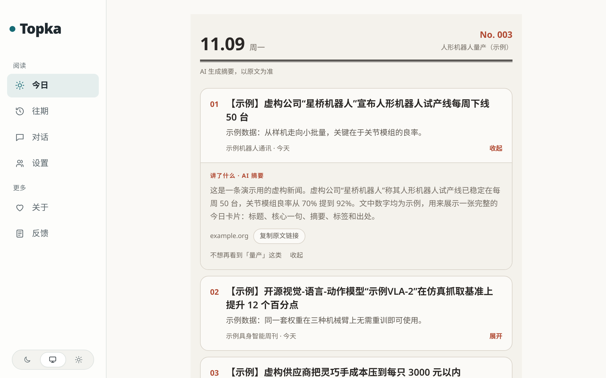

# Tutorial: from an empty machine to the first card on screen

**English** · [简体中文](tutorial.md)

By the end of this page you have a Topka site running on your own machine, showing a finished daily
issue. It needs **no API key and no GPU** and takes about 30 minutes, most of it the first image build.

- **Part 1** uses only the demo data that ships with the repository: every source, headline and number
  is invented. Nothing is fetched from the internet and no model is called.
- **Part 2** switches on two real RSS sources so you can watch real articles arrive. Model calls stay
  off, so articles are collected but not analysed.

A production deployment (HTTPS, backups, upgrades) is a separate step: read
[self-hosting.md](self-hosting.md) once this page works.

## What you need

- **Docker with Compose v2**: `docker compose version` prints a version. The database, backend and web
  server all run in containers; you do not install Node.js or PostgreSQL on the host.
- **`git`**.
- **About 3 GB of free disk** for the images. A 2-core / 4 GB machine is enough.
- **Port 3000 free on this machine.** If it is taken, put `PORT=127.0.0.1:3300` in front of every
  `docker compose up` on this page and read 3300 wherever it says 3000. The site is published on
  `127.0.0.1` only, so it opens on this machine; to open it from another one see
  [self-hosting.md → HTTPS](self-hosting.md#https-caddy-profile).

The UI and the demo content are in Chinese; this page translates every label you need.

## Part 1: the demo site

### 1. Get the code and generate `.env`

```bash
git clone https://github.com/CyrusAurora/topka.git && cd topka
docker run --rm -u "$(id -u):$(id -g)" -v "$PWD:/app" -w /app node:24-trixie-slim node scripts/init-env.ts
```

The second command runs `scripts/init-env.ts` in a throwaway Node container and writes `.env` with
random secrets (database password, session keys). `-u "$(id -u):$(id -g)"` makes the file yours rather
than root's. It prints, in Chinese:

```text
已生成 .env。
管理员密码：<random>（也写在 .env 的 ADMIN_PASSWORD 里）
还差一步：在 .env 里填上 LLM_API_KEY（以及 LLM_BASE_URL、LLM_MODEL，默认是 DeepSeek）。
```

That is ".env generated", "admin password: … (also in `ADMIN_PASSWORD` in .env)", and a reminder to
add a model key. **Ignore the reminder for now.** Leave `COLLECT_ENABLED=false` (no collection) and
`MODEL_CALLS_ENABLED=false` (no model calls) as they are.

With Node.js ≥ 24 on the host, `node scripts/init-env.ts` does the same without the container.

### 2. Start with the demo content

```bash
DEMO_SEED=true docker compose up -d --build
```

The first build takes 5–15 minutes depending on the network; once the image exists a start takes
seconds. The command ends with lines like these (order may vary):

```text
 Container topka-api-1  Started
 Container topka-worker-1  Started
 Container topka-web-1  Started
```

On the way, the one-shot `setup` container applies the migrations, imports the topics and the source
list (all switched off), and then, because `DEMO_SEED=true`, runs `scripts/demo.ts`, which creates:

- a reader account `demo@example.com`,
- one tracking project, "人形机器人量产（示例）" (humanoid robot mass production, example),
- three invented sources (`示例机器人通讯` and friends, `https://example.org/...` addresses, switched off
  so they are never fetched),
- nine invented stories: three in today's issue and three in each of the two previous days.

Instead of the variable on the command line you can set `DEMO_SEED=true` in `.env`.

Check that the services answer:

```bash
curl -s http://localhost:3000/api/health
```

```text
{"ok":true,"db":"ok","ms":1,"release":"dev"}
```

### 3. Read the demo password

It is random and printed once, when the account is created, in the setup log:

```bash
docker compose logs setup | grep demo:
```

```text
setup-1  | demo: ready. Log in at /login as demo@example.com
setup-1  | demo: password demo-1be4ef872d6d  (shown once; set DEMO_PASSWORD and re-run to reset it)
setup-1  | demo: project project:h7e5…, issues written for 2026-11-07, 2026-11-08 and 2026-11-09
```

Your password and dates differ. **Write the password down now**: when part 2 restarts the stack after editing `.env`, the `setup` container is recreated and these log lines are gone. To choose the password yourself, put
`DEMO_PASSWORD=<at least 10 characters>` in `.env` and run `docker compose exec api npm run demo:seed`
(this also adds the demo to a stack started without `DEMO_SEED`).

### 4. Log in and look

Open <http://localhost:3000/login> and sign in as `demo@example.com` with that password.

**You are done when you see:**

- **今日** (Today): issue **No. 003** with three numbered cards. Every title starts with `【示例】`
  ("example"): the demo says plainly that it is not real news.
- **Click a card's title**: it expands to the summary ("讲了什么 · AI 摘要", "what it says · AI
  summary"), the source domain (`example.org`) and a button to copy the original link (复制原文链接).
- **往期** (Past issues): the two earlier days, three titles each. Click one to open that day's issue.



To read the interface in English, open 设置 (Settings) and pick English; the demo's card titles stay
Chinese, since that is the language they were written in. The time zone picked there sets when your
issue is fixed: 08:00 in that zone, default Asia/Shanghai.

That is the whole product loop (sources, a tracking project, a daily issue of the top three stories)
on synthetic data. The admin UI is at <http://localhost:3000/admin> with the `ADMIN_PASSWORD` from
`.env`.

> Nothing on this screen changes by itself: with collection and model calls off, tomorrow's issue
> stays empty. Part 2, and then a model, make it move.

## Part 2: real articles, still no model key

Now let the site collect from two real RSS feeds. Model calls stay **off**, so you will see articles
arrive, but no scoring, no summaries and no new cards.

**1. Switch on two sources** (all others stay off):

```bash
docker compose exec api npm run sources:only -- --id rss-hugging-face --id rss-github-ai
```

Among the output are these two lines:

```text
.env not found. Continuing without it.
保持打开 2 个（新打开 2），关闭其余 0 个
```

The first line is expected: inside the container the settings come from Compose, not from a file, so
every `npm run` there prints it. The second reads "kept 2 on (2 newly on), switched 0 others off".
A few `npm notice` lines about a newer npm may follow; they are harmless.

The source list is also in the admin at <http://localhost:3000/admin/sources>; from a shell,
`docker compose exec api npm run sources:list` prints every id. The setup step loads the topic packs
and the bundled feed list, so about 400 sources exist in total and every one of them starts switched
off; `sources:only` turns the named ones on and all the others off.

**2. Turn collection on in `.env` and restart:**

```bash
sed -i 's/^COLLECT_ENABLED=false/COLLECT_ENABLED=true/' .env
docker compose up -d
```

If part 1 started the stack with `PORT=…` in front of the command, put it in front of this one too,
or the site comes back on 3000. `.env` already carries `DEMO_SEED=false` from `init-env`, so this
start adds no demo rows.

**3. Watch it work, within a few minutes:**

- **`/admin/sources`** is the place to watch: the two sources move to the top, each showing its last
  successful fetch and its item count for the last 7 days. `/admin/runs` next to it lists the
  scheduled jobs (the sweep, translation, the hot ranking), not the per-source fetches.
- **`/admin/content`** opens on the newest articles; the search box looks one up by id, URL or title.
- **`docker compose logs -f worker`** prints one line per fetch that stored something new (or failed):

  ```text
  worker-1  | {"level":"info","msg":"source fetch","source":"rss-github-ai","found":10,"new":8,"revised":0}
  ```

  A fetch that found nothing new stays silent, so a quiet feed produces no log noise.

The first import of a feed keeps up to 8 recent items; later runs add only what is new.

Compose also starts an `rsshub` container (about 470 MB) that the bundled Weibo sources use. The two
feeds above do not need it; it can stay idle.

**What will not appear:** the articles are not analysed, so they get no Chinese title, summary or
score, they do not enter the public pool, and 今日 gets no new cards. That needs a model: add a model
route to `.env` (or free models only, see [self-hosting.md](self-hosting.md#model-connection) and
[configuration.md](configuration.md)), set `MODEL_CALLS_ENABLED=true`, and `docker compose up -d`
again. Then create your own reader at `/register` and your own project from 对话 (chat) or 项目
(projects).

## Clean up

```bash
docker compose down -v   # stops everything and deletes the database volume
```

A plain `docker compose up -d --build` (without `DEMO_SEED`) then starts an empty site with no demo
rows. The demo seed refuses to run on a database that already has other users or non-demo articles,
unless you pass `--force` (`docker compose exec api npm run demo:seed -- --force`).

## Stuck?

| Symptom | Cause | Fix |
|---|---|---|
| `required variable POSTGRES_PASSWORD is missing a value` | No `.env` yet, or you are not in the `topka` directory | Run step 1's `init-env` |
| `Bind for …:3000 failed: port is already allocated` | Something else on the machine uses 3000 | Put `PORT=127.0.0.1:3300` in front of every `docker compose up`, open 3300 |
| `permission denied while trying to connect to the Docker daemon socket` | Your user may not talk to Docker | Add yourself to the `docker` group and log in again, or prefix the `docker` commands with `sudo` |
| No `demo:` lines in `logs setup` | The stack was started without `DEMO_SEED=true` | `docker compose exec api npm run demo:seed` |
| The demo password is gone | It is printed only when the account is created | Reset it with `DEMO_PASSWORD`, see step 3 |
| Sources on for minutes, still 0 items at `/admin/sources` | `COLLECT_ENABLED` not `true`, or no restart after the edit; or the network cannot reach the feeds | Check `.env`, run `docker compose up -d`; behind the mainland-China firewall see [self-hosting.md](self-hosting.md#note-on-deployment-in-mainland-china) |

Anything else: [self-hosting.md#troubleshooting](self-hosting.md#troubleshooting).
