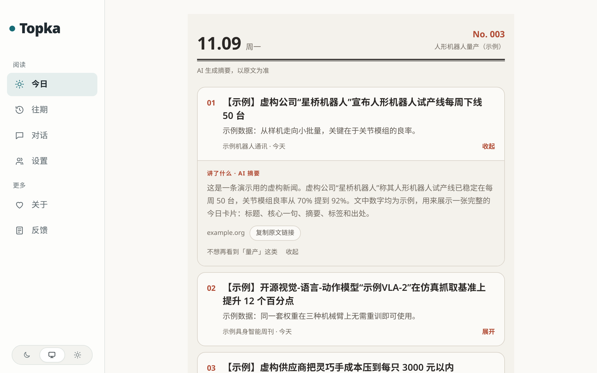

# 教程：从一台空电脑到屏幕上的第一张卡片

[English](tutorial.en.md) · **简体中文**

走完这一页，你会在自己电脑上跑起一个 Topka 站点，看到已经定稿的一期「今日」。全程**不需要 API key，也不需要 GPU**，大约 30 分钟，大部分时间花在第一次构建镜像上。

- **第一部分**只用仓库自带的演示数据：信源、标题、数字全是虚构的，不抓任何网站，也不调用模型。
- **第二部分**打开两个真实的 RSS 信源，看真实文章进来。模型仍然是关的，所以只采集、不分析。

正式部署（HTTPS、备份、升级）是另一回事，等这页走完再看 [self-hosting.md](self-hosting.md)。

## 需要什么

- **Docker 和 Compose v2**（Docker 把程序连同它依赖的一切装进「容器」里运行；Compose 一条命令拉起一组容器）。终端里跑 `docker compose version`，能打出版本号就行。Topka 的数据库、后端和网页都在容器里，你的电脑上不用装 Node.js 或 PostgreSQL。
- **`git`**。
- **大约 3 GB 磁盘**放镜像。2 核 4 GB 的机器就够。
- **本机 3000 端口空着**。被占了的话，在本页每一条 `docker compose up` 前面加上 `PORT=127.0.0.1:3300`，然后把下文的 3000 都换成 3300。站点默认只在本机能打开（只监听 `127.0.0.1`）；要让别的机器访问，看 [self-hosting.md 的 HTTPS 一节](self-hosting.md#https-caddy-profile)。

## 第一部分：演示站点

### 1. 拿代码，生成 `.env`

```bash
git clone https://github.com/CyrusAurora/topka.git && cd topka
docker run --rm -u "$(id -u):$(id -g)" -v "$PWD:/app" -w /app node:24-trixie-slim node scripts/init-env.ts
```

第二条命令在一个用完就删的 Node 容器里运行 `scripts/init-env.ts`，生成配置文件 `.env`：数据库密码、会话密钥这些都是随机生成的。`-u "$(id -u):$(id -g)"` 让生成的文件归你自己，而不是归 root。它会打印：

```text
已生成 .env。
管理员密码：（一串随机字符）（也写在 .env 的 ADMIN_PASSWORD 里）
还差一步：在 .env 里填上 LLM_API_KEY（以及 LLM_BASE_URL、LLM_MODEL，默认是 DeepSeek）。
```

最后一行提醒你填模型 Key，**这一部分先不用管**。`.env` 里的 `COLLECT_ENABLED=false`（不采集）和 `MODEL_CALLS_ENABLED=false`（不调用模型）也保持原样。

本机装了 Node.js 24 以上的话，直接 `node scripts/init-env.ts` 效果一样。

### 2. 带着演示数据启动

```bash
DEMO_SEED=true docker compose up -d --build
```

第一次要构建镜像，按网速大概 5 到 15 分钟；镜像有了以后，再启动只要几秒。命令结束时，最后几行类似这样（顺序可能不同）：

```text
 Container topka-api-1  Started
 Container topka-worker-1  Started
 Container topka-web-1  Started
```

启动过程中有一个只跑一次的 `setup` 容器：先做数据库迁移，再导入主题和信源列表（全部是关的），最后因为 `DEMO_SEED=true`，运行 `scripts/demo.ts` 写入：

- 一个读者账号 `demo@example.com`；
- 一个追踪项目「人形机器人量产（示例）」；
- 三个虚构信源（`示例机器人通讯` 等，地址都是 `https://example.org/...`，而且是关的，永远不会去抓）；
- 九条虚构新闻：今天一期三条，前两天各三条。

不想每次在命令前写 `DEMO_SEED=true`，也可以把它写进 `.env`。

确认服务起来了：

```bash
curl -s http://localhost:3000/api/health
```

```text
{"ok":true,"db":"ok","ms":1,"release":"dev"}
```

### 3. 拿到演示密码

密码是随机的，只在第一次创建账号时打印一次，在 `setup` 的日志里：

```bash
docker compose logs setup | grep demo:
```

```text
setup-1  | demo: ready. Log in at /login as demo@example.com
setup-1  | demo: password demo-1be4ef872d6d  (shown once; set DEMO_PASSWORD and re-run to reset it)
setup-1  | demo: project project:h7e5…, issues written for 2026-11-07, 2026-11-08 and 2026-11-09
```

你的密码和日期会和这里不一样。**现在就把密码记下来**：第二部分改完 `.env` 重启时，`setup` 容器会重建，这几行日志就看不到了。想自己定密码：在 `.env` 里加一行 `DEMO_PASSWORD=至少10个字符`，然后跑 `docker compose exec api npm run demo:seed`。启动时没带 `DEMO_SEED` 的站点，也可以用这条命令补上演示数据。

### 4. 登录，看一眼

打开 <http://localhost:3000/login>，用 `demo@example.com` 和刚才的密码登录。

**看到这些就成了：**

- **今日**：第 **No. 003** 期，三张编号卡片，每个标题都以【示例】开头。演示数据自己说明了它不是真新闻。
- **点开卡片标题**：展开「讲了什么 · AI 摘要」、出处域名（`example.org`）和「复制原文链接」按钮。
- **往期**：前两天的两期，每期三个标题，点进去是那天完整的一期。



信源、追踪项目、每天一期的前三条，整个产品的闭环就是这些，只是现在用的是假数据。后台在 <http://localhost:3000/admin>，用 `.env` 里的 `ADMIN_PASSWORD` 登录。

> 这个页面不会自己变：采集和模型都关着，第二天的那一期不会有内容。要它动起来，接着做第二部分，最后接上模型。

## 第二部分：接两个真实信源，仍然不用模型 Key

现在让站点从两个真实的 RSS 信源采集文章。模型调用还是**关的**，所以你会看到文章进来，但没有打分、没有摘要，也不会出新卡片。

**1. 只打开两个信源**（其余全部保持关闭）：

```bash
docker compose exec api npm run sources:only -- --id rss-hugging-face --id rss-github-ai
```

输出里有这两行：

```text
.env not found. Continuing without it.
保持打开 2 个（新打开 2），关闭其余 0 个
```

第一行是正常的：容器里的配置来自 Compose，而不是读 `.env` 文件，所以在容器里跑任何 `npm run` 都会先打这一行。后面可能还跟着几行 `npm notice`，说有新版 npm，也不用管。

全部信源的列表在后台 <http://localhost:3000/admin/sources>，命令行里 `docker compose exec api npm run sources:list` 会打出每个 id。启动时导入了主题包和自带的信源列表，一共大约 400 个，全部是关的；`sources:only` 打开指定的这几个，把其他的都关掉。

**2. 打开采集，重启：**

```bash
sed -i 's/^COLLECT_ENABLED=false/COLLECT_ENABLED=true/' .env
docker compose up -d
```

第一部分如果在命令前加了 `PORT=…`，这里也要加，不然站点会回到 3000。`init-env` 生成的 `.env` 里已经有 `DEMO_SEED=false`，所以这次启动不会再写演示数据。

**3. 几分钟内看它干活：**

- **`/admin/sources`** 最值得看：这两个信源排到最上面，显示上次成功抓取的时间和最近 7 天的条数。旁边的 `/admin/runs` 列的是定时任务（巡检、翻译、热榜），不是每次抓取。
- **`/admin/content`** 打开就是最新的文章；搜索框可以按 id、网址或标题找。
- **`docker compose logs -f worker`**：每次抓到新东西（或抓取失败）打一行，比如：

  ```text
  worker-1  | {"level":"info","msg":"source fetch","source":"rss-github-ai","found":10,"new":8,"revised":0}
  ```

  什么新东西都没抓到的那次不打日志，所以安静的信源不会刷屏。

一个信源第一次导入时最多留 8 条最近的文章，之后只收新的。

Compose 还会起一个 `rsshub` 容器（约 470 MB），给自带的微博信源用。上面两个 RSS 用不到它，让它闲着就行。

**不会出现的东西**：文章没有经过分析，所以没有中文标题、摘要和分数，不进公开内容池，「今日」也不会多出卡片。这一步需要模型：在 `.env` 里配好模型路由（或者只用免费模型，见 [self-hosting.md](self-hosting.md#model-connection) 和 [configuration.md](configuration.md)），把 `MODEL_CALLS_ENABLED=true`，再跑一次 `docker compose up -d`。然后在 `/register` 注册你自己的读者账号，在「对话」或「项目」里建你自己的追踪项目。

## 收尾

```bash
docker compose down -v   # 停掉所有容器，并删除数据库卷
```

之后不带 `DEMO_SEED` 直接 `docker compose up -d --build`，就是一个没有演示数据的空站点。演示数据也不会往已经有别的用户或真实文章的数据库里写，除非加 `--force`（`docker compose exec api npm run demo:seed -- --force`）。

## 卡住了

| 症状 | 原因 | 处理 |
|---|---|---|
| `required variable POSTGRES_PASSWORD is missing a value` | 还没生成 `.env`，或者不在 `topka` 目录里 | 回到第 1 步跑 `init-env` |
| `Bind for …:3000 failed: port is already allocated` | 本机别的程序在用 3000 | 每条 `docker compose up` 前面加 `PORT=127.0.0.1:3300`，打开 3300 |
| `permission denied while trying to connect to the Docker daemon socket` | 当前用户没有 Docker 权限 | 把用户加进 `docker` 组后重新登录，或者每条 `docker` 命令前加 `sudo` |
| `logs setup` 里没有 `demo:` 那几行 | 启动时没带 `DEMO_SEED=true` | `docker compose exec api npm run demo:seed` |
| 演示密码找不到了 | 密码只在第一次创建账号时打印 | 用 `DEMO_PASSWORD` 重设，见第 3 步 |
| 打开信源几分钟了，`/admin/sources` 里还是 0 条 | `COLLECT_ENABLED` 没改成 `true`，或者改完没重启；也可能是网络到不了海外 | 检查 `.env` 后再 `docker compose up -d`；国内网络见 [self-hosting.md](self-hosting.md#note-on-deployment-in-mainland-china) |

其他问题见 [self-hosting.md#troubleshooting](self-hosting.md#troubleshooting)。
