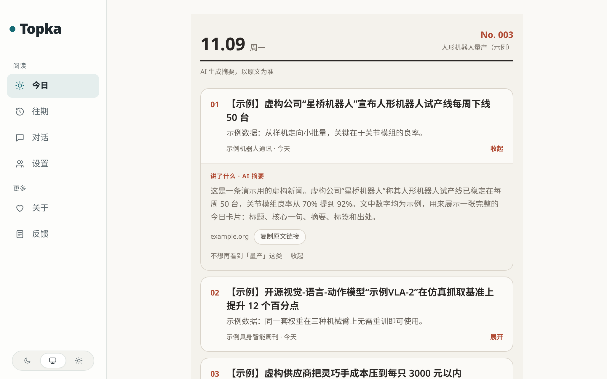

# 教程：从一台空电脑到屏幕上的第一张卡片

[English](tutorial.en.md) · **简体中文**

在自己电脑上跑起 Topka，看到一期「今日」。不需要 API key 和 GPU，大约 30 分钟，多数时间在第一次构建镜像。

- **第一部分**：用自带的演示数据跑起来。
- **第二部分**：打开两个真实的 RSS 信源，看文章进来。
- **第三部分**：建你自己的跟踪项目，再接一个免费模型（可选）。

HTTPS、备份和升级见 [self-hosting.md](self-hosting.md)。

## 需要什么

- **Docker 和 Compose v2**：`docker compose version` 能打出版本号就行。不用装 Node.js 或 PostgreSQL。
- **`git`**。
- **大约 3 GB 磁盘**放镜像。2 核 4 GB 的机器就够。
- **一个空闲端口**，默认 3000，设置在 `.env` 的 `PORT`。3000 被占就在第 1 步的 `init-env.ts` 后面加 `--port 127.0.0.1:3300`，下文的 3000 换成 3300。站点只在本机能打开；给别的机器用见 [HTTPS](self-hosting.md#https-caddy-profile)。

## 第一部分：演示站点

### 1. 拿代码，生成 `.env`

<!-- doc-test: run quickstart -->
```bash
git clone https://github.com/CyrusAurora/topka.git && cd topka
docker run --rm -u "$(id -u):$(id -g)" -v "$PWD:/app" -w /app node:26-trixie-slim node scripts/init-env.ts --demo
```

第二条命令在临时的 Node 容器里生成 `.env`，密码和密钥都是随机的。`--demo` 打开演示数据。它会打印：

```text
已生成 .env。网站地址：http://localhost:3000（改端口就改 .env 里的 PORT）
管理员密码：（一串随机字符）（也写在 .env 的 ADMIN_PASSWORD 里）
演示：DEMO_SEED=true，启动时写入演示数据；没接模型时「对话」由内置演示模型回答。
模型：LLM_API_KEY 还空着。接免费模型或本地 Ollama 见 docs/self-hosting.md#model-connection。
```

最后一行先不用管。再跑一次不会覆盖已有的 `.env`。

### 2. 带着演示数据启动

<!-- doc-test: run quickstart; timeout 1800 -->
```bash
docker compose up -d --build
```

第一次构建要半分钟到十几分钟，之后启动只要几秒。结束时类似：

```text
 Container topka-api-1  Started
 Container topka-worker-1  Started
 Container topka-web-1  Started
```

`setup` 容器会迁移数据库、导入信源和四个方向包（都关着），再写入演示数据：

- 一个读者账号 `demo@example.com`；
- 一个追踪项目「人形机器人量产（示例）」；
- 三个虚构信源（地址都是 `https://example.org/...`，不会去抓）；
- 九条虚构新闻：今天一期三条，前两天各三条。

确认服务起来了：

<!-- doc-test: run quickstart; retry 180; expect "ok":true -->
```bash
curl -s "http://$(docker compose port web 3000)/api/health"
```

```text
{"app":"topka","version":"1.0.0","ok":true,"db":"ok","ms":1,"release":"1.0.0"}
```

刚启动时可能是空响应，等几秒再试。

### 3. 拿到演示密码

密码只在第一次创建账号时打印一次：

<!-- doc-test: run quickstart; retry 180; expect demo: ready -->
```bash
docker compose logs setup | grep demo:
```

```text
setup-1  | demo: ready. Log in at /login as demo@example.com
setup-1  | demo: password demo-1be4ef872d6d  (shown once; to reset it: add DEMO_PASSWORD=<10+ characters> to .env, run `docker compose up -d`, then `docker compose exec api npm run demo:seed`)
setup-1  | demo: project project:h7e5…, issues written for 2026-11-07, 2026-11-08 and 2026-11-09
```

**现在就记下密码**，第二部分重启后这几行日志就没了。

自己定密码：

<!-- doc-test: run quickstart; retry 120; expect demo: password -->
```bash
echo 'DEMO_PASSWORD=至少10个字符' >> .env
docker compose up -d
docker compose exec api npm run demo:seed     # 打印 demo: password …（from DEMO_PASSWORD）
```

或者不改 `.env`，只对这一次生效：`docker compose exec -e DEMO_PASSWORD=至少10个字符 api npm run demo:seed`。如果 `.env` 里也有 `DEMO_PASSWORD`，下次 `docker compose up -d` 时 `setup` 会按 `.env` 里的值把密码改回去。

### 4. 登录，看一眼

打开 <http://localhost:3000/login>（换了端口就用 init-env 打印的地址），用 `demo@example.com` 和刚才的密码登录。

**看到这些就成了：**

- **今日**：No. 003，三张卡片，标题都以【示例】开头。
- **点开标题**：摘要、出处和「复制原文链接」。
- **往期**：前两期。
- **项目页**：「设置」里点「人形机器人量产（示例）」。



「设置」里可以把界面换成 English，也可以选时区：每天的一期在你所选时区的 08:00 定稿，默认 Asia/Shanghai。

后台在 <http://localhost:3000/admin>，密码是 `.env` 里的 `ADMIN_PASSWORD`。采集和模型都关着，所以明天不会有新一期，接着做第二部分。

## 第二部分：接两个真实信源，仍然不用模型 Key

从两个真实的 RSS 信源采集文章。模型还关着，所以文章会进来，但不会出新卡片。

**1. 只打开两个信源**（其余全部保持关闭）：

<!-- doc-test: run quickstart -->
```bash
docker compose exec api npm run sources:only -- --id rss-hugging-face --id rss-github-ai
```

输出是这一行：

```text
保持打开 2 个（新打开 2），关闭其余 3 个
```

关掉的 3 个是演示信源。全部信源在 <http://localhost:3000/admin/sources>，或者用 `docker compose exec api npm run sources:list` 列出 id。

**2. 打开采集，重启：**

<!-- doc-test: skip turns on collection, so the worker fetches real feeds from the internet; CI makes no outside calls -->
```bash
sed -i 's/^COLLECT_ENABLED=false/COLLECT_ENABLED=true/' .env
docker compose up -d
```

**3. 几分钟内看它干活：**

- **`/admin/sources`**：这两个信源排在最上面，显示上次抓取时间和最近 7 天的条数。
- **`/admin/content`**：最新的文章，可按 id、网址或标题搜索。文章页能看到历次版本（见 [ledger.md](ledger.md)）。
- **`/admin/discovery`**：固定信源之外的线索（见 [discovery.md](discovery.md)）。
- **`docker compose logs -f worker`**：抓到新内容或失败时打一行：

  ```text
  worker-1  | {"level":"info","msg":"source fetch","source":"rss-github-ai","found":10,"new":8,"revised":0}
  ```

新信源第一次最多收 8 条最近的文章，之后只收新的。没有模型，文章不会有摘要，也不会出卡片，见第三部分。

## 第三部分：建你自己的跟踪项目

**用向导。**「设置 → 新建项目」（`/projects/new`）先选一个方向包：AI 模型、具身智能与机器人、开源与开发者、半导体与算力。四个包在启动时都已导入（信源是关的），所以都能选。然后勾要重点看的信源（可按地区筛）→ 起名（留空就用包名）→ 预览 → 确认创建。

项目页会写明关联了几个信源、开着几个。项目不会替你打开信源，按第二部分打开。

**用「对话」。** 打开「对话」，说一句想跟踪什么，比如「帮我跟踪人形机器人」。没接模型时由演示模型回答：问两个问题（最关心哪类变化、不想看到什么），整理成一张跟踪卡片，确认后项目就建好了。说「删除人形机器人这个项目」会出删除卡片；说「取消」就结束这次问答。

**接一个不花钱的真实模型（可选）。** 两条路，具体每一行见 [self-hosting.md 的 Without a paid key](self-hosting.md#without-a-paid-key)：

- **本地 Ollama**，不用注册：

  <!-- doc-test: skip pulls a 4.7 GB local model and needs the memory to run it -->
  ```bash
  cat >> .env <<'EOF'
  COMPOSE_PROFILES=ollama
  LLM_BASE_URL=http://ollama:11434/v1
  LLM_API_KEY=ollama
  LLM_MODEL=qwen2.5:7b
  LLM_EXTRA_JSON=
  EOF
  sed -i 's/^MODEL_CALLS_ENABLED=false/MODEL_CALLS_ENABLED=true/' .env
  docker compose up -d
  docker compose exec ollama ollama pull qwen2.5:7b     # 4.7 GB，只下一次
  ```

  没有 GPU 时 7B 模型每轮 10–30 秒，约一半回答格式不合格（实测见 [self-hosting.md](self-hosting.md#without-a-paid-key)）。没有 GPU 就用下面的 `:free` 模型。
- **OpenRouter 的 `:free` 模型**：注册免费账号拿 Key，填 `LLM_FREE_MODELS`。只用报价为 0 的模型。

## 收尾

<!-- doc-test: run quickstart -->
```bash
docker compose down -v   # 停掉所有容器，并删除数据库卷
```

不要演示数据：`.env` 里 `DEMO_SEED=false`，再 `docker compose up -d --build`。

## 卡住了

| 症状 | 原因 | 处理 |
|---|---|---|
| `required variable POSTGRES_PASSWORD is missing a value` | 还没生成 `.env`，或者不在 `topka` 目录里 | 回到第 1 步跑 `init-env` |
| `Bind for …:3000 failed: port is already allocated` | 本机别的程序在用 3000 | `.env` 里改成 `PORT=127.0.0.1:3300`，`docker compose up -d`，打开 3300 |
| `curl` 健康检查是 200，浏览器里却不是 Topka | 问到了占着那个端口的别的服务 | 用第 2 步的 `curl -s "http://$(docker compose port web 3000)/api/health"` |
| `permission denied while trying to connect to the Docker daemon socket` | 当前用户没有 Docker 权限 | 把用户加进 `docker` 组后重新登录，或者每条 `docker` 命令前加 `sudo` |
| `logs setup` 里没有 `demo:` 那几行 | `.env` 里不是 `DEMO_SEED=true` | `docker compose exec api npm run demo:seed` |
| 演示密码找不到了 | 密码只在第一次创建账号时打印 | 用 `DEMO_PASSWORD` 重设，见第 3 步（别漏了 `docker compose up -d`） |
| 「对话」输入框是灰的 | 没接模型，也没开演示 | 见第三部分 |
| 打开信源几分钟了，`/admin/sources` 里还是 0 条 | `COLLECT_ENABLED` 没改成 `true`，或者改完没重启；也可能是网络到不了海外 | 检查 `.env` 后再 `docker compose up -d`；国内网络见 [self-hosting.md](self-hosting.md#note-on-deployment-in-mainland-china) |

其他问题见 [self-hosting.md#troubleshooting](self-hosting.md#troubleshooting)。
